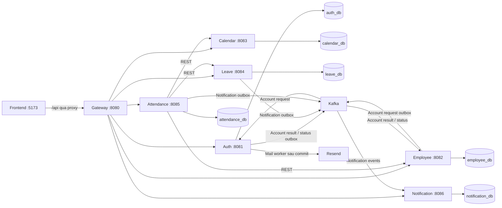
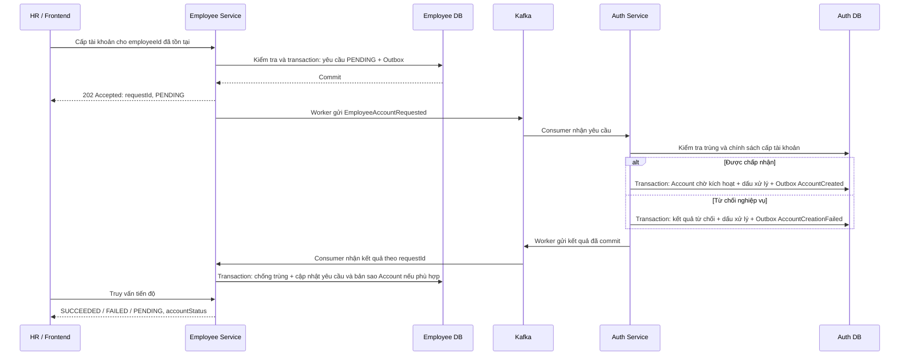

# Company HRM — Thiết kế tổng thể

**Mục lục**

- [Danh mục project](#danh-mục-project)
- [Kiến trúc và quyền sở hữu dữ liệu](#kiến-trúc-và-quyền-sở-hữu-dữ-liệu)
- [Phụ thuộc khi chạy độc lập](#phụ-thuộc-khi-chạy-độc-lập)
- [Các luồng nghiệp vụ chính](#các-luồng-nghiệp-vụ-chính)
- [Xác thực, quyền và tính nhất quán](#xác-thực-quyền-và-tính-nhất-quán)
- [Hiện trạng và lộ trình](#hiện-trạng-và-lộ-trình)
- [Quy ước phát triển và triển khai](#quy-ước-phát-triển-và-triển-khai)
- [Chạy local bằng Maven và Git Bash](#chạy-local-bằng-maven-và-git-bash)
- [Chạy HRM bằng Docker](#chạy-hrm-bằng-docker)
- [Hướng dẫn giao tiếp giữa các service HRM](#hướng-dẫn-giao-tiếp-giữa-các-service-hrm)
- [Kafka local cho HRM](#kafka-local-cho-hrm)

Hệ thống quản lý nhân sự theo kiến trúc microservices, lưu mã nguồn trong một
repository. **Mỗi backend và frontend là một project cấu hình, build, chạy và
dừng độc lập.** Không có Maven parent/aggregator dùng chung ở thư mục gốc.
Chạy một project không bắt buộc khởi động toàn bộ hệ thống; các chức năng tích
hợp vẫn cần đúng dịch vụ nguồn, database hoặc Kafka tương ứng.

Mỗi project có duy nhất một README chứa cấu hình, schema, API, nghiệp vụ và kiểm
thử của project đó. README này giữ thiết kế liên service, quy ước chạy độc lập,
hạ tầng dùng chung và lộ trình. SQL, OpenAPI và file cấu hình vẫn ở project sở hữu.

## Danh mục project

| Project / README | Vai trò | Cổng mặc định | Database |
| --- | --- | --- | --- |
| [Frontend](frontend/README.md) | Vue 3, JavaScript, Vite; giao diện tiếng Việt | 5173 | Không |
| [Gateway](back-end/modules/gateway/README.md) | Spring Cloud Gateway, JWT, CORS và định tuyến | 8080 | Không |
| [Auth](back-end/modules/auth-service-main/README.md) | Tài khoản, role, JWT, phiên, kích hoạt và email | 8081 | auth_db |
| [Employee](back-end/modules/employee-service/README.md) | Hồ sơ, phòng ban, chức danh, cấp tài khoản | 8082 | employee_db |
| [Calendar](back-end/modules/calendar-service/README.md) | Ngày nghỉ chung và sự kiện công ty | 8083 | calendar_db |
| [Leave](back-end/modules/leave-service/README.md) | Đơn nghỉ, số dư phép năm, xét duyệt | 8084 | leave_db |
| [Attendance](back-end/modules/attendance-service/README.md) | Ca, phân công, chấm công, đơn từ, OT, báo cáo | 8085 | attendance_db |
| [Notification](back-end/modules/notification-service/README.md) | Thông báo đơn từ, đã đọc và SSE | 8086 | notification_db |

Backend dùng Java 21 và Maven. Auth, Employee, Calendar, Attendance dùng JPA;
Leave và Notification dùng JDBC. Gateway dùng WebFlux; service nghiệp vụ dùng
Spring MVC. Phiên bản dependency được quản lý trong POM riêng của mỗi project.
Frontend dùng Node.js 24 theo package.json. Notification dùng Maven đã cài;
các backend còn lại có Maven Wrapper.

Đọc nhanh: [chạy độc lập](#local), [hợp đồng sự kiện](#events),
[Kafka local](#kafka), [Docker local](#docker),
[triển khai HTTPS](back-end/modules/gateway/README.md#deployment).

## Kiến trúc và quyền sở hữu dữ liệu



- Mỗi service sở hữu database, transaction và schema riêng. Có thể dùng cùng
  PostgreSQL local nhưng không query, tạo FK hoặc dùng JPA relationship xuyên database.
- Auth giữ tài khoản, mật khẩu, role và liên kết UUID employeeId bắt buộc/duy nhất.
  Employee giữ hồ sơ và trạng thái lao động; một nhân viên có thể chưa có account.
  accountStatus tại Employee là bản sao để hiển thị, không phải nguồn phân quyền.
- Calendar giữ ngày nghỉ chung; Leave giữ đơn nghỉ cá nhân và số dư; Attendance
  giữ lịch/ca, sự kiện gốc, giờ điều chỉnh và kết quả tính công. Holiday không phải
  loại đơn nghỉ, không tạo đơn nghỉ tự động cho từng nhân viên.
- Notification giữ thông báo và trạng thái đã đọc. Email kích hoạt vẫn do Auth
  gửi; Notification chưa thay thế worker email của Auth.
- Trong Compose HTTPS, tên workforce và workforce_db ánh xạ tới Calendar.
  Chưa có Workforce project riêng; calendar_db local không bị đổi tên.

## Phụ thuộc khi chạy độc lập

Các URL liên service là biến môi trường, có thể trỏ tới tiến trình local hoặc
môi trường khác. Mỗi project nạp cấu hình riêng. Dừng hoặc build lại một project
chạy thủ công không dừng các project còn lại.

| Project | Cần để khởi động tối thiểu | Cần thêm khi dùng chức năng tích hợp |
| --- | --- | --- |
| Auth | Database/schema, hai cặp RSA; tắt sự kiện và activation nếu chưa cấu hình | Kafka cho provisioning; Resend/cấu hình mail khi bật activation |
| Employee | Database/schema, access public key; HRM_EVENTS_ENABLED=false nếu không có Kafka | Kafka và Auth consumer để hoàn tất cấp tài khoản |
| Calendar | Database/schema, access public key | Auth để lấy token khi sử dụng API; CRUD không cần Kafka |
| Leave | Database/schema, access public key; thông báo tắt | Kafka và Notification để nhận thông báo mới |
| Attendance | Database/schema, access public key; thông báo tắt | Employee, Leave, Calendar qua REST cho nghiệp vụ; Kafka/Notification khi bật thông báo |
| Notification | Database/schema, access public key; consumer tắt | Kafka/topic và producer Leave/Attendance để có thông báo mới |
| Gateway | Access public key và các URL đích | Backend tương ứng phải sẵn sàng khi gọi route đó |
| Frontend | Node/npm, dependency riêng | Gateway + Auth để đăng nhập; service tương ứng cho từng màn hình |

Access public key được cấp từ Auth nhưng có thể lưu tại đường dẫn tuyệt đối của
từng project; không cần giữ cấu trúc thư mục service bên cạnh nhau để xác minh JWT.
Sau khi có key và token hợp lệ, resource server xác minh cục bộ, không gọi Auth
trên mỗi request. Health của một tiến trình không chứng minh cả luồng liên service
đã sẵn sàng. API Attendance không coi lỗi nguồn là không có phép/ngày nghỉ.

## Các luồng nghiệp vụ chính

### Cấp và kích hoạt tài khoản

1. HR/ADMIN tạo hồ sơ tại Employee. Tạo hồ sơ và cấp tài khoản là hai thao tác riêng.
2. Employee nhận yêu cầu có Idempotency-Key, lưu PENDING và outbox cùng transaction,
   trả 202 sau commit. Frontend đọc tiến độ tại Employee.
3. Auth nhận EmployeeAccountRequested, chống trùng, tạo account chờ kích hoạt với
   role EMPLOYEE và ghi kết quả/outbox. Không gửi mật khẩu hoặc token qua Kafka.
4. Employee nhận AccountCreated hoặc AccountCreationFailed, cập nhật đúng request.
   SUCCEEDED chỉ có nghĩa đã tạo account, chưa có nghĩa đã gửi mail hoặc đăng nhập được.
5. Khi bật activation, Auth gửi mail từ outbox qua Resend. Nhân viên đặt mật khẩu
   bằng token một lần; Auth phát AccountStatusChanged, Employee áp dụng version mới.

Email hồ sơ không tự đồng bộ sang email đăng nhập. Nghỉ việc chưa tự khóa account.
Luồng khóa/mở account, đối soát dữ liệu cũ và DLT vẫn cần hoàn thiện. Contract và
quy tắc retry nằm ở [giao tiếp sự kiện](#events);
cách thử API nằm trong [Employee](back-end/modules/employee-service/README.md#provisioning).

### Lịch, phép và chấm công

Attendance hiện hỗ trợ FIXED_SHIFT, ca ngắn/qua đêm, lịch mặc định công ty và
lịch riêng có ngày hiệu lực. Mỗi nhân viên có một ca và một cặp vào/ra thường
trong ngày công; ngày công của ca qua đêm là ngày bắt đầu ca. Mặc định ban đầu
08:00–12:00, 13:30–17:30, thứ Hai–thứ Sáu được tạo nếu chưa có lịch công ty.

Check-in/out dùng giờ server, nhân viên từ JWT, allowlist IP/CIDR và proxy tin cậy.
IP chỉ chứng minh đường mạng, không chứng minh Wi-Fi hoặc vị trí thực tế; browser
không cung cấp SSID đáng tin cậy cho backend. VPN/proxy phải được đối chiếu với
cấu hình mạng khi triển khai. Không nhận thời gian hoặc IP tự khai của client.

Ngày công giữ phiên bản ca bất biến và snapshot nguồn. Phép APPROVED/ngày nghỉ
Calendar có hiệu lực làm giảm phần phải làm. Trễ/sớm làm tròn riêng lên 15 phút;
giữ nguyên timestamp, tách giờ thực tế, công quy đổi, phép và OT. Thiếu cặp giờ
trả kết quả chưa xác định, không mặc định bằng 0. Vào sớm/ở lại muộn không tự bù công.

Đơn trễ/sớm đã duyệt xác nhận khoảng vắng có phép, vẫn trừ công và không trừ quỹ
phép. Điều chỉnh công qua xét duyệt giữ dữ liệu chấm gốc. OT duyệt trước và chấm
giờ riêng; số phút thực tế giao với khoảng được duyệt, không cộng vào công thường.
Thay đổi Leave/Calendar chưa tự cập nhật snapshot: HR dùng refresh coverage.
Bảng công/CSV là DRAFT, chưa có khóa kỳ hoặc tính lương.

Leave dùng ANNUAL/UNPAID, bước nửa ngày; phép năm mặc định 12 ngày/năm, chỉ trừ
khi duyệt. Hiện còn tính theo ngày lịch, chưa loại cuối tuần/ngày lễ. Không tự
suy ra quy tắc lương hoặc phép part-time từ công thức tính phút.

Thiết kế chi tiết, ví dụ tính công và phần mở rộng nằm trong
[Attendance](back-end/modules/attendance-service/README.md#design). WorkTimeSupport là helper
nội bộ cùng project, [chưa nối các trường công hưởng lương vào API/UI](back-end/modules/attendance-service/README.md#worktime).

## Xác thực, quyền và tính nhất quán

- Access và refresh token dùng hai cặp RSA RS256 riêng. Chỉ Auth giữ private key;
  service khác nhận access public key, cùng issuer/audience. sub là account ID,
  employee_id là UUID hồ sơ. Chưa có JWKS/multiple kid.
- Có EMPLOYEE, MANAGER, HR, ADMIN; account có nhiều role, không có role hierarchy.
  HR/ADMIN quản trị nghiệp vụ hiện có; MANAGER chưa có quyền duyệt theo team.
  Mỗi API kiểm tra quyền/phạm vi ở backend; không dựa vào việc UI ẩn nút.
- Auth đọc account/role hiện tại từ DB; các resource server dùng claim JWT.
  Logout thu hồi refresh session, không thu hồi tức thì access JWT ở service khác.
  TTL mặc định tại Auth: access 1 ngày, refresh 7 ngày, có thể ghi đè khi triển khai.
- Frontend giữ access token trong bộ nhớ; refresh token trong localStorage dùng
  chung giữa tab, đồng bộ bằng Web Locks. Chưa có HttpOnly cookie.
- Transaction theo nghiệp vụ, gồm dữ liệu + audit + idempotency/outbox nếu áp dụng.
  Constraint/lock/version bảo vệ thao tác đồng thời. Không có transaction chung
  giữa database, REST, Kafka và Resend; gọi ngoài diễn ra sau commit qua worker.
- Retry cùng thao tác giữ Idempotency-Key khi API hỗ trợ. If-Match dùng version
  hiện tại; 412 yêu cầu tải lại. Kiểm tra contract từng API vì chưa thống nhất
  response envelope hoặc hỗ trợ idempotency cho mọi POST.
- Sự kiện có thể giao trùng/sai thứ tự; consumer chống trùng và áp version tại
  nguồn. PENDING lâu cần kiểm tra outbox/consumer, không tự kết luận thất bại.

## Hiện trạng và lộ trình

| Hạng mục | Đã có | Còn lại |
| --- | --- | --- |
| Tài khoản | Login/refresh/logout, provisioning, kích hoạt/email, trạng thái sau kích hoạt | Khóa/mở account, đối soát cũ, DLT, thu hồi quyền tức thì |
| Hồ sơ | Nhân viên/phòng ban/chức danh, tự cấp mã EMP bằng sequence, quản lý trực tiếp | Hợp đồng, lịch sử điều chuyển, hồ sơ mở rộng, quyền dữ liệu nhạy cảm |
| Calendar | CRUD, publish/cancel, audit/version, lịch chung audience ALL | Audience theo tổ chức, lặp/nhắc lịch, tổng hợp ca/phép/OT |
| Leave | Cả/nửa ngày, số dư năm, duyệt/từ chối/rút, REST coverage | Tính phép theo lịch/ngày lễ, ledger, hoàn phép/hủy sau duyệt, quản lý theo team |
| Attendance | Ca cố định/qua đêm, lịch, check-in/out, trễ/sớm, correction, OT, CSV | FLEXIBLE_DURATION, nhiều ca/phiên, chốt kỳ/revision, đồng bộ nguồn |
| Notification | Producer outbox, consumer, danh sách/đã đọc/SSE | Frontend, hai bộ Compose, email/push và sự kiện correction/OT |
| Device / Payroll / Recruitment / Performance | Chưa triển khai | Phân tích và nghiệm thu từng phạm vi riêng |

Ưu tiên là hoàn thiện và nghiệm thu luồng Attendance hằng ngày, rồi đối soát/chốt
công và tích hợp phép theo lịch. Các mốc v0.1–v1.x là lộ trình, không dùng để suy
ra tính năng đã phát hành: ca qua đêm, correction, OT và Notification backend
đã có dù từng nằm trong phase sau.

1. Attendance MVP: kiểm chứng mạng, quyền, snapshot, concurrency, correction,
   CSV cùng kết quả với API; migration và backup/restore cho pilot.
2. Attendance mở rộng: nhiều ca/phiên, break events, FLEXIBLE_DURATION, khóa/mở
   kỳ có audit/revision. Flex chỉ mở sau khi đủ tính công, UI và chính sách phép;
   hiện backend vẫn từ chối mode này, chưa có chức năng ADMIN mở khóa.
3. Leave/Calendar: tính theo lịch cá nhân/ngày lễ, ledger, phạm vi người duyệt,
   đồng bộ có version và calendar tổng hợp bảo vệ lý do nghỉ riêng tư.
4. Device: adapter cho vendor thực tế, xác thực nguồn, mapping nhân viên,
   chống trùng provider/device/event ID, đối soát offline/sai thứ tự/đồng hồ lệch.
   Giữ event chưa ánh xạ để xử lý; không mặc định lưu mẫu sinh trắc học.
5. HR/employee experience: hồ sơ theo nhóm dữ liệu, hợp đồng, lịch sử tổ chức có
   hiệu lực, dashboard và thông báo. Chuyển phòng ban không làm mất lịch sử.
6. Payroll/Recruitment/Performance: phạm vi và tiêu chí riêng. Payroll cần công/phép
   đã đối soát và khóa kỳ, cùng cơ chế điều chỉnh hồi tố.

## Quy ước phát triển và triển khai

Phân tích thay đổi từ actor, điều kiện, luồng chính/lỗi, quyền, dữ liệu và audit.
Giữ business logic trong service, controller/listener mỏng, dependency injection,
validation đúng tầng và transaction rõ ràng. Không tạo abstraction hoặc service
mới khi chưa có nhu cầu cụ thể; không dùng entity/repository chung xuyên project.

Kiểm thử tại project thay đổi. Mock/H2 hữu ích cho logic nhưng không thay kiểm
chứng khóa, constraint, transaction PostgreSQL hoặc offset/retry Kafka thật.
Giữ test hiện có; ưu tiên test service cho mở rộng provisioning. Khi trình bày
implementation, giải thích nghiệp vụ, dữ liệu, luồng, quyền, transaction và edge
case cần thiết; bám phạm vi yêu cầu và phân biệt hiện trạng với đề xuất.

SQL nằm trong docs/sql của từng backend. Chưa có Flyway/Liquibase; init schema
không phải migration nâng cấp database cũ. Chỉ database/volume mới được init tự
động trong Compose. Dữ liệu đang dùng cần migration và đối soát riêng.

Docker local và launcher chạy nhóm là lựa chọn tiện dụng, không phải điều kiện
build/chạy từng project. Hai bộ Compose hiện gồm Gateway và 5 service nghiệp vụ,
chưa có Notification. Frontend production build/host riêng khi dùng bộ HTTPS.
Chi tiết TLS, secrets và network nằm trong README Gateway.

Nếu triển khai AWS, có thể build image → ECR → ECS/Fargate; VPC/subnet/security
group phải cấu hình khi triển khai. Chưa có hạ tầng AWS hoàn chỉnh trong repo.
Pilot cần HTTPS, DB private, secret ngoài source, trusted proxy, health/log/audit,
backup và thử khôi phục. Scale, cache, broker hoặc service mới dựa trên số liệu
tải và độ tin cậy; không mặc định thêm Redis/SQS/EventBridge.

<a id="local"></a>

## Chạy local bằng Maven và Git Bash

Repository có **7 ứng dụng backend** và frontend Vite. Mỗi backend chạy riêng
bằng `mvn spring-boot:run`, hoặc chạy cả nhóm bằng `run-all.sh` sau khi chuẩn bị
cấu hình và hạ tầng.

<a id="local-chuẩn-bị"></a>

### Chuẩn bị

- Java 21, Maven, Node.js 24 LTS và npm trên `PATH`.
- PostgreSQL đang chạy, có database/user và schema cho từng service bên dưới.
- Hai cặp khóa RSA access/refresh: Auth giữ private key; các service xác minh JWT
  dùng cùng access public key, issuer và audience. Xem [JWT](back-end/modules/auth-service-main/README.md#jwt).
- Kafka khi bật cấp tài khoản hoặc thông báo. Xem [Kafka local](#kafka).
- Chạy `npm ci` trong `frontend` trước lần chạy đầu.

| Service / thư mục trong `back-end/modules` | Cổng | Database local |
| --- | --- | --- |
| `gateway` | 8080 | Không có |
| `auth-service-main` | 8081 | `auth_db` |
| `employee-service` | 8082 | `employee_db` |
| `calendar-service` | 8083 | `calendar_db` |
| `leave-service` | 8084 | `leave_db` |
| `attendance-service` | 8085 | `attendance_db` |
| `notification-service` | 8086 | `notification_db` |

Owner thông thường là `<service>_user`. Schema nằm trong `docs/sql` của từng
module. Dùng schema khởi tạo cho database mới; database đã có dữ liệu cần đối
chiếu migration của module, không chạy lại hoặc xóa database để sửa lỗi khởi động.
Leave và Attendance cần thêm `004_notification_outbox.sql` nếu bật thông báo.
Employee có migration `003_employee_code_sequence.sql` cho database cũ chưa có sequence mã nhân viên.

<a id="local-cấu-hình-env"></a>

### Cấu hình `.env`

Mỗi module có `.env.example`; sao chép thành `.env` rồi điền database, đường dẫn
khóa và địa chỉ dịch vụ phù hợp. File `.env` thật được Git bỏ qua. Không dùng
`.env` ở thư mục gốc cho Maven: file gốc dành cho [Docker Compose](#docker).

Các mẫu backend hiện trỏ tới PostgreSQL `127.0.0.1:55432`, Kafka `127.0.0.1:9092`
và khóa trong `keys/` của chính từng service. Cấu hình datasource mặc
định trong mã nguồn thường dùng cổng `5432`.
Nếu tự cài PostgreSQL, sửa `SPRING_DATASOURCE_URL`, username/password tương ứng.

Chuẩn bị `.env` thủ công từ mẫu của từng project; giữ nguyên file đã cấu hình.
Auth dùng `file:./keys/` cho bốn khóa; các service khác chỉ cần
`JWT_ACCESS_PUBLIC_KEY=file:./keys/access-public.pem` với bản sao access public key
của cùng môi trường Auth, được cấp riêng cho từng service.
Các đường dẫn tương đối này tính từ thư mục từng module, không phải thư mục gốc repo.
Nếu chạy IDE với working directory khác, đặt đường dẫn `file:/...` tuyệt đối.
Máy mới tạo hai cặp khóa theo [hướng dẫn JWT](back-end/modules/auth-service-main/README.md#jwt-tạo-khóa-cho-local).
Khóa runtime không được commit; nếu đã có bộ khóa ở vị trí khác, dùng lại và đặt
đường dẫn thực tế trong `.env`/IDE. Khi sửa biến môi trường, nạp lại và restart service.

Mỗi service có thể được triển khai độc lập ở máy/container khác. Khi đóng gói hoặc
triển khai, cấp public key vào `<service>/keys/access-public.pem`, hoặc mount vào
đường dẫn riêng rồi đặt `JWT_ACCESS_PUBLIC_KEY=file:/duong-dan/access-public.pem`.
Các bản sao phải cùng nội dung với access public key tương ứng khóa ký của Auth.
Chỉ Auth nhận private key và bộ khóa refresh. Sau khi thay public key, restart
các service để nạp lại; clone repo mới cần cấp key vì `keys/` được Git bỏ qua.

| Tính năng | Service | Mặc định ứng dụng |
| --- | --- | --- |
| `HRM_EVENTS_ENABLED` | Auth / Employee | Auth `false`, Employee `true` |
| `HRM_NOTIFICATIONS_ENABLED` | Leave / Attendance / Notification | `false` |
| `AUTH_ACTIVATION_ENABLED` | Auth | `false` |

Giá trị đã đặt trong `.env` ghi đè mặc định ứng dụng; kiểm tra các cờ này trước
khi chạy, nhất là khi môi trường chưa có Kafka hoặc cấu hình mail.

Nếu chạy không có Kafka, đặt hai cờ sự kiện/thông báo thành `false` tại các module
liên quan; luồng cấp tài khoản và thông báo sẽ không hoạt động. Nếu bật thông báo,
chuẩn bị topic `hrm.requests.notifications.v1` theo [Notification](back-end/modules/notification-service/README.md).
Email kích hoạt cần cấu hình riêng theo [hướng dẫn activation](back-end/modules/auth-service-main/README.md#activation).

<a id="local-chạy-từng-service-trong-git-bash"></a>

### Chạy từng service trong Git Bash

Ví dụ Auth, bắt đầu từ thư mục gốc project:

```bash
cd back-end/modules/auth-service-main
set -a
source ./.env
set +a
mvn spring-boot:run
```

Mở terminal riêng cho mỗi service, đổi tên thư mục trong lệnh `cd`. Phải chạy từ
thư mục module để đường dẫn khóa tương đối đúng. Maven/Spring Boot không tự đọc
file `.env`; các lệnh `source` ở trên xuất biến cho tiến trình Java. Sau khi sửa
`.env`, dừng service, nạp lại biến và chạy lại. Trong IDE, import các biến vào Run
Configuration và đặt working directory là thư mục module.

Frontend, từ thư mục gốc trong terminal khác:

```bash
cd frontend
npm ci
npm run dev
```

Vite tự đọc `frontend/.env` (`API_PROXY_TARGET=http://127.0.0.1:8080`). Nếu có
`.env.local`, giá trị cùng tên trong file đó được ưu tiên. Mở `http://localhost:5173`.
Tài khoản demo chỉ có sau khi áp seed tương ứng; xem [Auth](back-end/modules/auth-service-main/README.md).

`spring-boot:run` hiện không tự theo dõi thay đổi source để biên dịch/restart.
Khi sửa một backend, nhấn `Ctrl+C` ở terminal của service đó rồi chạy lại Maven;
các service còn lại tiếp tục chạy. Frontend có HMR của Vite.

<a id="local-chạy-nhóm-bằng-run-allsh"></a>

### Chạy nhóm bằng `run-all.sh`

Sau khi đã chuẩn bị hạ tầng, schema, khóa, `.env` và dependency frontend:

```bash
bash run-all.sh
```

Script chạy trên Git Bash, Linux hoặc WSL, cần Java, Maven, Node/npm và quyền
thực thi các Maven Wrapper. Không cần `setsid` hoặc `wait -n`: Node quản lý các
tiến trình; Windows dùng `taskkill /T` để dừng cây tiến trình của từng ứng dụng.
Notification dùng Maven đã cài, các backend còn lại dùng Maven Wrapper.
Trên Windows, launcher gọi `mvn.cmd`, `mvnw.cmd` và `npm.cmd` qua `cmd.exe`
để giữ cây tiến trình cho `taskkill /T`; Linux/WSL dùng `mvn`, `./mvnw` và `npm`.

Nếu thiếu Vite hoặc gặp lỗi `'vite' is not recognized`, chạy
`cd frontend && npm ci --include=dev` rồi chạy lại script từ thư mục gốc.
Script kiểm tra Vite trước khi khởi động các backend.
Trong PowerShell, dùng `npm.cmd` nếu `npm.ps1` bị execution policy chặn;
chạy script bằng `& 'C:/Program Files/Git/bin/bash.exe' ./run-all.sh`
để chọn đúng Git Bash thay vì `bash.exe` của WSL trên `PATH`.

Script nạp `.env` của từng ứng dụng và khởi chạy 7 backend + frontend. Log hiện
ngay trên terminal với tiền tố tên service. `Ctrl+C` hoặc một ứng dụng thoát sẽ
dừng cả nhóm. Script không khởi tạo/dừng PostgreSQL hay Kafka, không chờ health
của từng service và không tự restart khi lưu source.

Thư mục `scripts` chỉ giữ [run-all.mjs](scripts/run-all.mjs), phần quản lý tiến
trình được `run-all.sh` gọi, và [run-all.test.mjs](scripts/run-all.test.mjs).
Kiểm thử launcher từ thư mục gốc bằng `node --test scripts/run-all.test.mjs`;
test dùng các tiến trình Node tạm để kiểm tra nạp `.env`, working directory và
dừng cây tiến trình, không khởi động backend hoặc kết nối database.

<a id="local-dừng-và-xử-lý-cổng-bận"></a>

### Dừng và xử lý cổng bận

Dừng service chạy thủ công bằng `Ctrl+C` trong terminal tương ứng. Kafka và
PostgreSQL có vòng đời riêng; dừng Maven hoặc `run-all.sh` không dừng hạ tầng.
Kafka chạy bằng Compose riêng được dừng bằng lệnh sau từ thư mục gốc:

```bash
docker compose -f back-end/modules/infra/kafka/compose.yaml stop
```

Nếu dùng Kafka native, dừng ở terminal/công cụ đã khởi chạy Kafka. Kiểm tra tiến
trình giữ cổng trên Windows bằng PowerShell:

```powershell
Get-NetTCPConnection -LocalPort 9092 -State Listen |
  Select-Object LocalAddress, LocalPort, OwningProcess
```

Đối chiếu PID với tiến trình trước khi dừng; không chạy thêm broker trên cùng
cổng. Cluster PostgreSQL cũ trong `.cache/local/postgres` cần được quản lý bằng
`pg_ctl` của bản PostgreSQL tương thích hoặc công cụ đã khởi chạy nó. Giữ nguyên
thư mục dữ liệu và khóa khi khởi động lại.

<a id="docker"></a>

## Chạy HRM bằng Docker

Bộ [compose.yaml](compose.yaml) tại thư mục gốc dành cho phát triển local, gồm
frontend Vue/Nginx, API Gateway, Auth, Employee, Calendar, Leave, Attendance,
5 PostgreSQL database riêng và Kafka. Không cần cài Java, Maven, Node hoặc
PostgreSQL trên máy host. Bộ này có **6 backend gồm Gateway**, chưa triển khai
Notification (`8086`), database/topic thông báo hoặc SQL outbox `004`. Các cờ
`HRM_NOTIFICATIONS_ENABLED` vẫn mặc định tắt; route Notification trong Gateway
chưa có backend đích trong Compose. Xem [Notification](back-end/modules/notification-service/README.md)
cho cách chạy native. `.env` gốc dành cho Compose, không nạp `.env` của từng module.

<a id="docker-khởi-động"></a>

### Khởi động

Mở Docker Desktop, dùng **Linux containers** và đợi Docker Engine sẵn sàng.
Cần Docker Compose **2.24 trở lên** (hỗ trợ `!reset`); kiểm tra bằng
`docker version` và `docker compose version`. Nên cấp khoảng 8 GB RAM cho Docker
để chạy đồng thời các JVM, PostgreSQL và Kafka.

Tại thư mục gốc repository:

```powershell
docker compose config --quiet
docker compose up -d --build --wait --wait-timeout 600
docker compose ps
```

Lần đầu cần Internet để tải base images, Maven dependencies và npm packages.
Compose tự tạo hai cặp RSA JWT, tạo schema và nạp seed demo trên các volume mới.
`keys-init` và `kafka-init` kết thúc với mã `0` là bình thường; các service ứng dụng
đợi khóa, database, Kafka topics và backend phụ thuộc sẵn sàng.

- Giao diện: **http://localhost:5173**.
- Gateway health: **http://localhost:8080/actuator/health**.
- Tài khoản demo: **admin@company.com**, mật khẩu **Admin@123456**.
- Có thể thử `hr@company.com`, `manager@company.com`, `employee@company.com`
  với cùng mật khẩu. Dữ liệu này lấy từ seed Auth/Employee hiện có.

Chỉ frontend và Gateway publish cổng, bind vào `127.0.0.1`. Database và Kafka
không chiếm cổng PostgreSQL/Kafka trên máy host. Frontend gửi `/api/...` cùng
origin qua Nginx tới Gateway; route Vue vẫn mở được khi tải lại trang.

<a id="docker-cấu-hình-tùy-chọn"></a>

### Cấu hình tùy chọn

Không bắt buộc tạo `.env`. Nếu cần đổi cổng hoặc cấu hình email, sao chép
[.env.example](.env.example) thành `.env` (không ghi đè nếu đã có):

```powershell
Copy-Item .env.example .env
# Ví dụ sửa FRONTEND_PORT=3000, GATEWAY_PORT=8088 rồi chạy lại:
docker compose up -d --build --wait --wait-timeout 600
```

Trên Bash dùng `cp .env.example .env`. Frontend URL, CORS và URL trang kích hoạt
tự dùng `FRONTEND_PORT`. `GATEWAY_PORT` chỉ thay cổng host; Nginx vẫn gọi cổng
8080 trong Docker.

Email kích hoạt mặc định tắt. Muốn thử luồng gửi mail, đặt
`AUTH_ACTIVATION_ENABLED=true`, `AUTH_ACTIVATION_TOKEN_SECRET`, `RESEND_FROM`
và `RESEND_API_KEY` theo [hướng dẫn Auth](back-end/modules/auth-service-main/README.md#activation).
Các tài khoản seed đã kích hoạt, không cần mail để đăng nhập. Tài khoản cấp mới
cần luồng kích hoạt; cấp tài khoản thành công không đồng nghĩa đăng nhập được ngay.

<a id="docker-attendance-trong-bộ-local"></a>

### Attendance trong bộ local

Gateway chuyển tiếp `/api/v1/attendance/**` tới Attendance và yêu cầu access JWT.
Attendance gọi Employee, Calendar và Leave qua DNS nội bộ của Compose.

Network local dùng `172.30.80.0/24`, Nginx tại `172.30.80.10`, Gateway tại
`172.30.80.20`. Các container còn lại nhận IP động trong `172.30.80.128/25`,
tách khỏi hai IP tĩnh để tránh lỗi `Address already in use` khi khởi động.
Mặc định chỉ tin Gateway và cho chấm công qua Nginx local;
Gateway nhìn thấy IP của Nginx, **không phải IP thực của trình duyệt**. Đây là
cấu hình demo trên máy cá nhân, không dùng để xác thực mạng công ty trong production.
Gọi check-in trực tiếp qua cổng 8080 có thể bị từ chối do khác IP.
Đặt `ATTENDANCE_ALLOWED_NETWORKS=` để từ chối toàn bộ check-in/out.

Đăng nhập HR/Admin để tạo/phân công ca trước khi thử chấm công bằng tài khoản
nhân viên. Ca mặc định trong schema chưa được tự gán cho nhân viên.
Nếu subnet trùng VPN/network đã có, thay subnet và hai địa chỉ tĩnh trong
`compose.yaml`, đồng thời cập nhật allowlist và trusted proxy tương ứng.

<a id="docker-log-cập-nhật-và-dữ-liệu"></a>

### Log, cập nhật và dữ liệu

```powershell
docker compose logs --tail=100 gateway auth employee calendar leave attendance
docker compose logs -f attendance
docker compose up -d --build --wait --wait-timeout 600
docker compose stop
docker compose start
docker compose down
```

`down` giữ dữ liệu. Các volume có prefix `company-hrm_`, tách biệt bộ HTTPS
`hrm` cũ và database local. Khóa JWT giữ nguyên qua restart/rebuild; chỉ Auth
mount volume private key, các service khác chỉ nhận public keys.

Script SQL chỉ chạy khi database volume trống. Thay schema hoặc mật khẩu trong
`.env` không tự cập nhật database đã có: áp migration/đổi mật khẩu DB phù hợp
trước khi chạy bản mới. Sao lưu cả dữ liệu và volume khóa khi cần giữ phiên đăng nhập.

Chỉ khi muốn **xóa toàn bộ dữ liệu demo và khóa JWT** để khởi tạo lại:

```powershell
docker compose down --volumes
docker compose up -d --build --wait --wait-timeout 600
```

Nếu service unhealthy, xem log service và database tương ứng. Lỗi kết nối Docker
Engine cần khởi động Docker Desktop trước. Nếu cổng 5173/8080 đã được dùng, đổi
cổng qua `.env` như trên.

Nếu đang dùng network từ cấu hình cũ chưa có `ip_range`, cần tạo lại network
để áp dụng dải IP động mới. Chạy hai lệnh sau, giữ nguyên các volume dữ liệu:

```powershell
docker compose down
docker compose up -d --wait --wait-timeout 600
```

Không thêm `--volumes` khi sửa lỗi mạng. Không cần build lại image cho thay đổi này.

<a id="docker-bộ-backend-https-hiện-có"></a>

### Bộ backend HTTPS hiện có

[back-end/modules/infra/gateway](back-end/modules/gateway/README.md#deployment) là cấu
hình riêng cho Gateway HTTPS, secret files và database networks riêng; đã bổ sung
Attendance cùng database. Bộ đó không tự nạp tài khoản demo, không build frontend,
và yêu cầu chứng chỉ TLS, mật khẩu DB, khóa JWT và cấu hình mạng công ty riêng.

<a id="events"></a>

## Hướng dẫn giao tiếp giữa các service HRM

<a id="events-1-thiết-kế-đã-chọn"></a>

### 1. Thiết kế đã chọn

**Employee là nguồn dữ liệu chính về nhân viên. Khi người dùng muốn cấp tài khoản,
Employee xác minh nhân viên và gửi `EmployeeAccountRequested` qua Kafka. Auth tạo
Account gắn với `employeeId`, rồi gửi kết quả về Employee.**

```text
Tạo hồ sơ: UI → Employee → lưu Employee → trả employeeId
Cấp tài khoản: UI → Employee → Outbox → EmployeeAccountRequested → Kafka → Auth
Kết quả: Auth → Outbox → AccountCreated / AccountCreationFailed → Kafka → Employee → UI
```

Tạo nhân viên và yêu cầu cấp tài khoản là hai thao tác riêng. Không chọn cấp tài
khoản thì không gửi yêu cầu sang Auth. Employee không lưu `accountId`, nhưng sở hữu
trạng thái yêu cầu cấp tài khoản. Auth sở hữu Account và liên kết `employeeId`.

Không cần thêm service nghiệp vụ. Worker và consumer chạy trong từng ứng dụng.
Hai service không cần hoạt động cùng lúc để trao đổi message, miễn dữ liệu còn
được lưu và bên nhận hoạt động lại. Không giữ HTTP request mở để chờ Auth xử lý.

Lộ trình triển khai nằm ở [mục 10](#events-10-lộ-trình-triển-khai-theo-phase). Đây là thiết
kế đích; mục 2 phân biệt với code đã có.

<a id="events-2-phần-đã-có-và-phần-cần-triển-khai"></a>

### 2. Phần đã có và phần cần triển khai

| Thành phần | Trạng thái |
|---|---|
| `Employee.accountStatus` và response tương ứng | Đã có enum; nhân viên mới mặc định `NOT_CREATED`; client không được sửa qua API hồ sơ |
| Schema Employee | `employee-service/docs/sql/001_employee_schema.sql` đầy đủ; database cũ cần đối chiếu và migration riêng |
| Kafka local và cấu hình hai service | Đã bổ sung topic yêu cầu/kết quả, group và smoke test; xem [hướng dẫn](#kafka) |
| API yêu cầu cấp tài khoản, bảng yêu cầu, `EmployeeAccountRequested` | Đã triển khai; bật bằng `HRM_EVENTS_ENABLED=true` sau schema đầy đủ của Auth/Employee và Kafka topics |
| Outbox hai phía, claim/lease, producer/consumer, chống trùng và kết quả | Đã triển khai cho cấp tài khoản và nhận trạng thái sau kích hoạt; chưa có DLT/đối soát |
| Auth tạo tài khoản chờ kích hoạt | Đã có `activation_pending=true`, `is_active=false`, role `EMPLOYEE`; đã có email Resend, token một lần/hết hạn và API kích hoạt |
| Đồng bộ trạng thái và đối soát tài khoản cũ | Đã nhận `AccountStatusChanged` sau kích hoạt; đối soát tài khoản cũ chưa triển khai |

Flow này không cần `employee_references` tại Auth hoặc lỗi `EMPLOYEE_NOT_SYNCED`.
`EmployeeCreated` có thể phục vụ sự kiện vòng đời cho phân hệ khác sau này; không
là điều kiện tiên quyết cho yêu cầu cấp tài khoản. Xem [cách chạy flow đã có](back-end/modules/employee-service/README.md#provisioning).
Auth mặc định `HRM_EVENTS_ENABLED=false`, Employee mặc định `true`; bật cả hai sau khi chuẩn bị schema/topics. Auth cần `docs/sql/001_auth_schema.sql`, Employee cần
`docs/sql/001_employee_schema.sql` trong thư mục từng service ngay cả khi chưa bật sự kiện. Khi bật ở Auth, `/register` cũ trả `409` để không bỏ qua Outbox.
Phạm vi quyền API mới hiện là HR/ADMIN toàn hệ thống, chưa chia theo phòng ban/tenant.

<a id="events-3-quyền-sở-hữu-dữ-liệu"></a>

### 3. Quyền sở hữu dữ liệu

| Thành phần | Trách nhiệm |
|---|---|
| Employee | Hồ sơ, phòng ban, chức danh, `EmployeeStatus`; xác minh nhân viên, quyền yêu cầu cấp tài khoản; lưu và theo dõi yêu cầu |
| Auth | Account, mật khẩu, role, token; kiểm tra chính sách cấp tài khoản và quyết định kết quả; giữ `employeeId` |
| Kafka | Lưu và phân phối yêu cầu/kết quả |
| Frontend | Tạo hồ sơ, gửi yêu cầu cấp tài khoản, truy vấn tiến độ tại Employee |

Mỗi service sở hữu database/schema riêng, không đọc/ghi bảng của service khác và
không tạo foreign key xuyên database. `accountStatus` tại Employee là bản sao để
hiển thị, không là nguồn quyết định quyền truy cập. `EmployeeStatus` mô tả việc làm
và không được cập nhật bằng kết quả cấp tài khoản từ Auth.

<a id="events-4-tạo-nhân-viên-và-yêu-cầu-cấp-tài-khoản"></a>

### 4. Tạo nhân viên và yêu cầu cấp tài khoản

1. UI tạo nhân viên tại Employee, nhận `201 Created` cùng `employeeId` sau commit.
2. Khi HR/ADMIN chọn cấp tài khoản, UI gửi yêu cầu riêng tới Employee bằng ID đó.
3. Employee kiểm tra quyền/phạm vi dữ liệu, nhân viên tồn tại, email đăng nhập và
   dữ liệu yêu cầu. Không tin `employeeId`, role hoặc danh tính người yêu cầu chỉ
   vì client gửi lên. MVP cấp role `EMPLOYEE`; cấp quyền cao hơn cần luồng có phân quyền riêng.
4. Trong một transaction, lưu yêu cầu `PENDING` và Outbox chứa
   `EmployeeAccountRequested`. Chỉ trả `202 Accepted` sau commit, kèm `requestId`.
5. Worker đọc Outbox đã commit, gọi `AccountProvisioningProducer` gửi lên Kafka.
   Chỉ đánh dấu đã gửi khi broker xác nhận; lỗi gửi được retry từ Outbox.

API đã triển khai, cần bật cờ sự kiện sau khi tạo schema và Kafka topics:

| API tại Employee | Mục đích |
|---|---|
| `POST /api/v1/employees/{employeeId}/account-requests` | Ghi nhận yêu cầu; body gồm email đăng nhập, không có mật khẩu; trả `202` và `requestId`, `provisioningStatus=PENDING` |
| `GET /api/v1/employees/{employeeId}/account-requests/{requestId}` | Trả tiến độ và mã lỗi nghiệp vụ nếu có; kiểm tra quyền xem |

POST dùng `Idempotency-Key` để lần gửi lại do mất HTTP response trả cùng yêu cầu;
unique key phải được ràng buộc trong database theo phạm vi người gọi. Cùng key
nhưng payload khác trả `409`. Chỉ cho phép một yêu cầu đang chờ trên một nhân viên,
kiểm soát nguyên tử trong database. Sau thất bại nghiệp vụ, sửa dữ liệu và tạo yêu
cầu mới với key/`requestId` mới. Không tạo hàng loạt yêu cầu mới khi chưa rõ kết quả cũ.

<a id="events-5-auth-xử-lý-và-trả-kết-quả"></a>

### 5. Auth xử lý và trả kết quả



Auth tin việc Employee đã xác minh ID khi yêu cầu đến từ producer được xác thực,
đúng topic và ACL. Trường `producer` trong JSON không phải bằng chứng xác thực.
Auth không gọi lại Employee hoặc đợi một `EmployeeCreated` chỉ để kiểm tra ID.
Sự xác minh này phản ánh thời điểm yêu cầu được chấp nhận; không bảo đảm trạng thái
lao động không thay đổi trong lúc message chờ. Quy tắc nghỉ việc/hủy yêu cầu cần
luồng vòng đời riêng khi mở rộng.

Auth vẫn kiểm tra schema, email, role theo chính sách và các ràng buộc unique cho
`employeeId`/email. Consumer gọi service nghiệp vụ nội bộ, không gọi vòng lại API
`/register` hoặc bỏ qua phân quyền của API đó. Không có JWT người dùng trong Kafka;
Employee kiểm tra quyền tại thời điểm nhận yêu cầu, Auth áp dụng chính sách cấp
role phía mình. `requestedBy` chỉ dùng audit, không tự cấp quyền dựa trên giá trị đó.

Không gửi mật khẩu, hash mật khẩu hoặc token kích hoạt qua Kafka. Thiết kế đích
là Auth tạo Account chờ kích hoạt, quản lý việc gửi lời mời và thiết lập mật khẩu
qua kênh riêng. Đã bổ sung `activation_pending` và chặn đăng nhập trước kích hoạt.
Đã có API thiết lập mật khẩu, token một lần/hết hạn và mail outbox gửi qua Resend.
Xem [cấu hình và API kích hoạt](back-end/modules/auth-service-main/README.md#activation).
`activation_pending=true` phân biệt tài khoản chờ kích hoạt với tài khoản bị khóa. Không dùng mật khẩu mặc định chung để lấp phần còn thiếu.

Khi `hrm.events.enabled=true` tại Auth, `/api/v1/auth/register` trả `409`, hướng
người gọi sang Employee. Khi cờ tắt, API cũ vẫn nhận mật khẩu và tạo tài khoản active;
không phát sự kiện. UI của flow mới chỉ gửi yêu cầu tại Employee.

<a id="events-6-trạng-thái-yêu-cầu-và-trạng-thái-tài-khoản"></a>

### 6. Trạng thái yêu cầu và trạng thái tài khoản

<a id="events-61-trạng-thái-yêu-cầu-cấp-tài-khoản"></a>

#### 6.1. Trạng thái yêu cầu cấp tài khoản

Lưu trong bảng yêu cầu riêng ở Employee, không thêm vào enum `AccountStatus`.

| Trạng thái | Ý nghĩa |
|---|---|
| `NOT_REQUESTED` | UI chưa có yêu cầu; không cần tạo bản ghi yêu cầu giả |
| `PENDING` | Đã ghi nhận, chưa có kết quả cuối |
| `SUCCEEDED` | Auth đã tạo Account; chưa đồng nghĩa đã kích hoạt |
| `FAILED` | Auth từ chối do nghiệp vụ, có `errorCode` |

Kết quả đối chiếu cả `requestId` và `employeeId`; cập nhật đúng bản ghi yêu cầu.
Kết quả cũ không được ghi đè trạng thái của lần yêu cầu mới. `PENDING` quá lâu cần
cảnh báo/đối soát, không tự kết luận chưa có Account hoặc chuyển thành `FAILED` chỉ
vì timeout. Tạo Account thất bại không xóa Employee.

<a id="events-62-bản-sao-accountstatus"></a>

#### 6.2. Bản sao accountStatus

| Giá trị | Ý nghĩa |
|---|---|
| `NOT_CREATED` | Chưa có tài khoản theo thông tin hiện biết |
| `PENDING_ACTIVATION` | Đã có tài khoản, chờ thiết lập mật khẩu/kích hoạt |
| `ACTIVE` | Tài khoản đang hoạt động |
| `DISABLED` | Tài khoản bị vô hiệu hóa |

Không lưu thêm `hasAccount` hoặc `accountId`. Khi nhận `AccountCreated`, yêu cầu
chuyển `SUCCEEDED`, còn `accountStatus` lấy từ payload của Auth (flow mới dự kiến
`PENDING_ACTIVATION`). `AccountCreationFailed` chỉ cập nhật yêu cầu, không đặt lại
`accountStatus`: lỗi trùng có thể xảy ra vì Account đã tồn tại.

Auth đã phát `AccountStatusChanged` khi kích hoạt. Phát sự kiện khi khóa/mở tài
khoản và trạng thái `NOT_CREATED` khi xóa thuộc thiết kế mở rộng, chưa có API.
Cần `accountVersion` tăng dần theo liên kết nhân viên,
lưu cả khi xóa/tạo lại Account. Employee chỉ áp dụng bản sao có version mới hơn.
Hoàn tất yêu cầu dựa trên `requestId` độc lập với việc áp dụng bản sao: kết quả tạo
đến muộn vẫn có thể hoàn tất đúng yêu cầu, nhưng không được ghi đè trạng thái khóa
có version cao hơn đã nhận trước đó.

Auth đã có `User.activationPending`: true ứng với `PENDING_ACTIVATION` và bắt buộc
inactive. Với tài khoản không chờ kích hoạt, `User.active` true/false ứng với
`ACTIVE`/`DISABLED`. API hoàn tất kích hoạt đã có. Trong development, dùng mặc định `NOT_CREATED`, không
có trạng thái `UNKNOWN`. Schema Employee đầy đủ không dùng `has_account`;
script chỉ tạo bảng/index còn thiếu, không tự chuyển đổi cột hay trạng thái cũ.
Database cũ cần đối chiếu và migration riêng trước khi chạy phiên bản hiện tại.

<a id="events-7-hợp-đồng-sự-kiện"></a>

### 7. Hợp đồng sự kiện

<a id="events-71-employeeaccountrequested"></a>

#### 7.1. EmployeeAccountRequested

Đây là message yêu cầu cấp tài khoản. Payload đề xuất cho MVP:

```json
{
  "eventId": "f749ce13-a512-47d1-a0d7-52e9fc40709b",
  "eventType": "EmployeeAccountRequested",
  "schemaVersion": 1,
  "occurredAt": "2026-09-25T03:00:00Z",
  "producer": "employee-service",
  "correlationId": "90c92fe5-9adc-4d35-ac24-3c5ad52c7701",
  "requestId": "ad96c1d8-d0d9-477c-a47b-7aed14d46db1",
  "data": {
    "employeeId": "d38e31b7-0bba-420c-8eaf-50edbe5a61ae",
    "email": "employee@example.com",
    "requestedBy": "42"
  }
}
```

`requestedBy` lấy từ principal đã xác thực ở Employee. Email là email đăng nhập
được xác nhận trong yêu cầu, có thể khác email liên hệ của hồ sơ. Không gửi toàn
bộ Employee. MVP không nhận role tùy ý; Auth tự gán `EMPLOYEE` theo chính sách đã chốt.

<a id="events-72-accountcreated"></a>

#### 7.2. AccountCreated

```json
{
  "eventId": "da98033a-72d8-4792-8ba2-e498b5a814fb",
  "eventType": "AccountCreated",
  "schemaVersion": 1,
  "occurredAt": "2026-09-25T03:00:01Z",
  "producer": "auth-service",
  "correlationId": "90c92fe5-9adc-4d35-ac24-3c5ad52c7701",
  "requestId": "ad96c1d8-d0d9-477c-a47b-7aed14d46db1",
  "data": {
    "employeeId": "d38e31b7-0bba-420c-8eaf-50edbe5a61ae",
    "accountStatus": "PENDING_ACTIVATION",
    "accountVersion": 1
  }
}
```

<a id="events-73-accountcreationfailed"></a>

#### 7.3. AccountCreationFailed

```json
{
  "eventId": "95f37f52-9d72-4dd6-83bc-e996216344cd",
  "eventType": "AccountCreationFailed",
  "schemaVersion": 1,
  "occurredAt": "2026-09-25T03:00:01Z",
  "producer": "auth-service",
  "correlationId": "90c92fe5-9adc-4d35-ac24-3c5ad52c7701",
  "requestId": "ad96c1d8-d0d9-477c-a47b-7aed14d46db1",
  "data": {
    "employeeId": "d38e31b7-0bba-420c-8eaf-50edbe5a61ae",
    "errorCode": "EMAIL_ALREADY_USED"
  }
}
```

Quy ước:

- `eventId`: chống trùng message; retry vận chuyển giữ nguyên ID và payload.
- `requestId`: chống thực thi trùng yêu cầu; kết quả giữ nguyên ID của yêu cầu.
- `correlationId`: nối log hai chiều; kết quả có `eventId` mới, cùng correlation/request/employee ID.
- `schemaVersion` là phiên bản cấu trúc; `accountVersion` là phiên bản dữ liệu do Auth sở hữu.
- Mã lỗi nghiệp vụ ổn định: `ACCOUNT_ALREADY_EXISTS`, `EMAIL_ALREADY_USED`; không phát
  `EMPLOYEE_NOT_SYNCED` vì không còn bước đợi đồng bộ ID. Lỗi hạ tầng được retry.
- Key Kafka là `employeeId`. Không giả định có thứ tự toàn cục giữa topic hoặc qua retry.
- `AccountStatusChanged` dùng payload trạng thái/version như `AccountCreated`, có
  `eventId`/`correlationId` riêng; không bắt buộc `requestId` của lần cấp cũ và không
  dùng nó để chuyển trạng thái yêu cầu cấp tài khoản.

<a id="events-8-outbox-retry-và-chống-trùng"></a>

### 8. Outbox, retry và chống trùng

Employee lưu yêu cầu + Outbox trong cùng transaction. Auth lưu Account, kết quả
xử lý và Outbox kết quả trong cùng transaction. Với từ chối nghiệp vụ, lưu kết quả
thất bại + Outbox mà không tạo Account. Unique constraint có thể làm transaction
bị rollback; phải xử lý xung đột và ghi kết quả trong transaction hợp lệ, không
bắt lỗi rồi tiếp tục ghi trên transaction đã bị đánh dấu rollback.

Worker đọc bản ghi đã commit, gửi theo lô, dùng claim/lease khi chạy nhiều instance,
retry có backoff và chỉ đánh dấu đã gửi sau broker ack. Crash sau ack nhưng trước
đánh dấu có thể gửi trùng; producer idempotence không thay thế consumer chống trùng.

- Consumer ghi dấu chống trùng cùng transaction với nghiệp vụ: Employee dùng
  `provisioning_processed_events`; Auth lưu event/request và kết quả trong
  `account_provisioning_results`.
- Auth còn lưu unique `requestId`, payload/kết quả tương ứng và unique employee/email.
  Cùng yêu cầu được giao lại thì không tạo Account mới hoặc đổi kết quả thành lỗi
  trùng; dùng kết quả đã lưu và Outbox để hoàn tất giao nhận.
- Yêu cầu mới cho nhân viên đã có Account trả `ACCOUNT_ALREADY_EXISTS`; không tự
  gắn lại email/tài khoản hoặc kích hoạt tài khoản đang bị khóa. Có đối soát riêng.
- Employee đối chiếu request/employee, kiểm soát cập nhật phiên bản nguyên tử và
  chỉ commit offset sau transaction database thành công.

| Tình huống | Xử lý |
|---|---|
| Employee không tồn tại/không đủ quyền | Từ chối tại Employee trước khi ghi yêu cầu/Outbox |
| Transaction ghi yêu cầu thất bại | Rollback yêu cầu và Outbox; hồ sơ đã tạo trước đó vẫn giữ nguyên |
| Kafka hoặc Auth tạm dừng | Outbox/message chờ xử lý; yêu cầu vẫn `PENDING` |
| Auth lỗi database tạm thời | Rollback và retry, không phát lỗi nghiệp vụ giả |
| Auth từ chối email/tài khoản trùng | Phát `AccountCreationFailed`; chỉ yêu cầu chuyển `FAILED` |
| Account đã tạo nhưng kết quả chưa đến | Outbox Auth tiếp tục gửi; theo dõi và đối soát |
| Kết quả không khớp request/employee | Không cập nhật nhầm hồ sơ; đưa vào quy trình kiểm tra/retry/DLT |
| Payload lỗi hoặc retry vượt ngưỡng | Hiện retry, chưa có DLT; thiết kế mở rộng cần DLT/cảnh báo/replay và chỉ ack gốc khi chuyển DLT thành công |

Chốt retention Kafka, Outbox và dấu chống trùng theo downtime/replay. Không xóa dấu
chống trùng trong khi còn khả năng chạy lại message liên quan. Kafka không giữ dữ
liệu vô hạn và không tạo transaction nguyên tử chung với database hai service.

<a id="events-9-topic-và-mở-rộng-service"></a>

### 9. Topic và mở rộng service

Topic/group đã cấu hình cho luồng mới (đã có listener trạng thái sau kích hoạt):

| Topic | Message | Producer | Consumer group |
|---|---|---|---|
| `hrm.employee.account-requests.v1` | `EmployeeAccountRequested` | Employee | Auth: `auth-account-requests-v1` |
| `hrm.auth.account-results.v1` | `AccountCreated`, `AccountCreationFailed` | Auth | Employee: `employee-account-results-v1` |
| `hrm.auth.account-lifecycle.v1` | `AccountStatusChanged`, snapshot khi mở rộng | Auth | Employee: `employee-account-lifecycle-v1` |

Compose đã tạo hai topic yêu cầu/kết quả, giữ `hrm.employee.lifecycle.v1`,
`hrm.auth.account-lifecycle.v1` để mở rộng và `hrm.local.smoke.v1` để thử kết nối.
Consumer hiện nghe cả topic yêu cầu, kết quả và trạng thái sau kích hoạt.
`KafkaConnectionTests` kiểm tra kết nối riêng; xem [Kafka local](#kafka).

Payroll/Leave có thể nghe `EmployeeCreated`/`EmployeeTerminated` qua topic vòng đời
sau này, không nghe yêu cầu cấp tài khoản. Mỗi bên cần nhận đủ message có consumer
group riêng; instance của cùng bên dùng chung group để chia tải. Khi Employee cần
nhận kết quả và vòng đời tài khoản, cấu hình group riêng theo listener, không ép
hai loại xử lý vào một group mặc định duy nhất.

REST dùng để tạo hồ sơ, ghi nhận yêu cầu và đọc tiến độ. Chỉ thêm Saga/workflow
khi có quy trình nhiều bước, thứ tự, timeout và bù trừ cần quản lý rõ ràng. Sự kiện
khóa Account có độ trễ; JWT đã cấp có thể còn hiệu lực, cần thiết kế thu hồi riêng
nếu yêu cầu chặn quyền ngay.

<a id="events-10-lộ-trình-triển-khai-theo-phase"></a>

### 10. Lộ trình triển khai theo phase

Outbox và chống trùng được triển khai từ lần đầu giao tiếp nghiệp vụ. Hạ tầng local
và luồng cấp tài khoản chờ kích hoạt đã có. Đã có kích hoạt tối thiểu; cần hoàn tất các phần
phục hồi/đối soát còn thiếu trước khi tuyên bố hoàn thành MVP hoặc production. MVP hoàn thành ở phase 3; production cần
các tiêu chí phase 4–6.

| Phase | Mục tiêu | Kết quả kiểm chứng |
|---|---|---|
| 0 | Chốt hợp đồng và chuẩn bị service | API yêu cầu, quyền, lỗi, trạng thái và thiết lập mật khẩu rõ ràng |
| 1 | Hạ tầng local | Topic/group đúng flow mới, hai service kết nối được |
| 2 | Employee gửi yêu cầu | Hồ sơ độc lập; yêu cầu + Outbox cùng commit; worker gửi đúng Kafka |
| 3 | Auth xử lý và trả kết quả | Account chờ kích hoạt, Employee nhận thành công/thất bại, kích hoạt được |
| 4 | Phục hồi và dữ liệu cũ | Retry, sai thứ tự, khóa/mở, đối soát hoạt động |
| 5 | Staging | Kiểm chứng tải, bảo mật, transaction và phục hồi |
| 6 | Production | Rollout, giám sát, rollback và vận hành |

<a id="events-phase-0--chốt-hợp-đồng-và-chuẩn-bị-service"></a>

#### Phase 0 — Chốt hợp đồng và chuẩn bị service

1. Chốt API mục 4, envelope mục 7, topic/group mục 9, unique và idempotency key.
   Không bổ sung `employee_references` hoặc điều kiện `EMPLOYEE_NOT_SYNCED` cho flow này.
2. Phân quyền tạo hồ sơ/yêu cầu tại tầng service Employee, kiểm tra phạm vi nhân
   viên được quản lý. Auth mặc định cấp `EMPLOYEE`; chốt luồng riêng để cấp quyền cao hơn.
3. Chuẩn bị mô hình tài khoản chờ kích hoạt, cách thiết lập mật khẩu và gửi lời mời
   do Auth sở hữu; thiết kế retry gửi lời mời riêng, tránh tạo lại Account.
4. Chốt kết quả `ACCOUNT_ALREADY_EXISTS`/`EMAIL_ALREADY_USED` và việc ghi nhận lỗi
   unique khi xử lý đồng thời. Hoàn thiện validation BCrypt theo byte cho các
   đường đặt mật khẩu; không chuyển thành lỗi 500 ngoài dự kiến.
5. Chốt kiểm soát `/register` cũ và migration tăng dần. Giữ `ddl-auto: validate`;
   không dùng script reset database để nâng cấp dữ liệu hiện có.

**Hoàn thành khi:** hợp đồng và quy tắc rõ ràng; test service xác nhận quyền, lỗi
đầu vào, phạm vi cấp role và thiết kế kích hoạt đã sẵn sàng để triển khai.

<a id="events-phase-1--dựng-kafka-local"></a>

#### Phase 1 — Dựng Kafka local

**Đã có:** [Compose, cấu hình Spring và smoke test](#kafka), topic
`hrm.employee.account-requests.v1`/`hrm.auth.account-results.v1`, group riêng cho hai
consumer. Vẫn giữ volume, healthcheck và topic smoke. Một broker local không là
cấu hình production.

<a id="events-phase-2--employee-gửi-yêu-cầu-cấp-tài-khoản"></a>

#### Phase 2 — Employee gửi yêu cầu cấp tài khoản

**Đã triển khai:** API, idempotency key, bảng yêu cầu, Outbox và worker gửi Kafka.

| Dữ liệu bổ sung tại Employee | Mục đích |
|---|---|
| `account_provisioning_requests` | requestId, employeeId, email, requestedBy, idempotency key/hash, trạng thái, lỗi, thời điểm |
| `event_outbox` | eventId, aggregateId, type, payload, trạng thái gửi, retry và claim/lease |

1. Giữ tạo Employee độc lập. Thêm API yêu cầu/truy vấn có phân quyền ở mục 4.
2. Lưu yêu cầu `PENDING` và Outbox `EmployeeAccountRequested` cùng transaction;
   kết quả HTTP `202` chỉ xác nhận đã tiếp nhận.
3. Worker gọi `AccountProvisioningProducer`, key là `employeeId`; chỉ đánh dấu
   Outbox sau broker ack. Retry giữ nguyên `eventId`, `requestId` và payload.
4. Chống yêu cầu đồng thời bằng ràng buộc database; mất response HTTP gửi lại cùng
   idempotency key trả cùng yêu cầu. Không phụ thuộc vào bản sao `accountStatus`
   để kết luận chắc chắn Auth chưa có Account.

**Hoàn thành khi:** không chọn cấp tài khoản thì không phát yêu cầu. ID không tồn
tại/không đủ quyền bị từ chối; rollback không để lại Outbox; Kafka tắt thì yêu cầu
vẫn được ghi `PENDING` và gửi lại khi broker phục hồi. Chưa có consumer Auth thì
chưa tuyên bố flow cấp tài khoản hoàn thành.

<a id="events-phase-3--auth-tạo-account-và-employee-nhận-kết-quả"></a>

#### Phase 3 — Auth tạo Account và Employee nhận kết quả

**Đã có phần cấp tài khoản:** Auth tạo Account chờ kích hoạt, ghi kết quả/Outbox;
Employee nhận và cập nhật yêu cầu/bản sao theo version. Đã có luồng đặt mật khẩu/
kích hoạt và cập nhật sau kích hoạt qua `AccountStatusChanged`. Nghiệm thu phase
cần kiểm chứng cả luồng thành công, thất bại và khôi phục bên dưới.

| Service | Dữ liệu bổ sung |
|---|---|
| Auth | `account_provisioning_results`, `event_outbox`, `account_link_versions`, trạng thái/kích hoạt tài khoản |
| Employee | `provisioning_processed_events`, `employee_account_versions` để chống trùng và cập nhật bản sao |

1. Consumer Auth validate message rồi gọi service nghiệp vụ; tin xác minh ID của
   Employee qua nguồn nội bộ được kiểm soát. Không gọi lại Employee chỉ để xác minh ID.
2. Chống trùng event/request và ràng buộc unique employee/email. Lưu Account chờ
   kích hoạt + kết quả xử lý + Outbox `AccountCreated` cùng transaction; từ chối
   nghiệp vụ ghi `AccountCreationFailed`. Lỗi hạ tầng rollback/retry.
3. `account_link_versions` tăng nguyên tử theo employeeId, không xóa khi xóa Account.
   Kết quả chứa request/employee/correlation ID đúng yêu cầu; không cần accountId.
4. Consumer Employee hoàn tất đúng yêu cầu và cập nhật bản sao theo version trong
   cùng transaction với dấu chống trùng. Kết quả cũ không ghi đè yêu cầu mới hoặc
   trạng thái Account mới hơn. API sửa hồ sơ không được ghi đè cột trạng thái từ entity cũ.
5. Auth cung cấp luồng thiết lập mật khẩu/kích hoạt, sau đó phát
   `AccountStatusChanged` với version mới để Employee chuyển sang `ACTIVE`.
   Gửi lời mời có retry riêng; tài khoản chờ kích hoạt không đăng nhập được.
6. UI theo dõi tại Employee: `PENDING` → `SUCCEEDED`/`FAILED`; hiển thị trạng thái
   kích hoạt riêng. Chỉ báo Account đã tạo khi nhận kết quả Auth.

**Hoàn thành khi:** tạo hồ sơ → yêu cầu tại Employee → Auth tạo Account → Employee
hiển thị `SUCCEEDED`/`PENDING_ACTIVATION` → kích hoạt → `ACTIVE`. Luồng thất bại
trả lỗi rõ ràng; retry không tạo Account thứ hai; consumer khôi phục sau downtime
trong retention. Không tự xóa Employee khi tạo Account thất bại.

<a id="events-phase-4--phục-hồi-lỗi-trạng-thái-và-dữ-liệu-đã-tồn-tại"></a>

#### Phase 4 — Phục hồi lỗi, trạng thái và dữ liệu đã tồn tại

**Phạm vi:** chuẩn bị hệ thống để chịu gián đoạn và nâng cấp từ dữ liệu hiện có.

1. Hoàn thiện claim/lease của worker cho nhiều instance, giới hạn batch, retry có
   backoff và thu hồi lease hết hạn. Không giữ transaction database dài trong lúc
   chờ mạng. Chỉ worker còn quyền claim mới đánh dấu bản ghi đã gửi.
2. Phân biệt lỗi tạm thời với payload không hợp lệ. Thêm dead-letter topic (DLT),
   thông tin lỗi và quy trình kiểm tra/chạy lại. Chỉ bỏ qua message ở topic gốc
   sau khi lưu chuyển sang DLT thành công; lỗi gửi DLT cũng phải được retry.
3. Khi replay cùng sự kiện, giữ `eventId`; consumer đã thành công sẽ bỏ qua. Nếu
   sửa payload để phát sự kiện thay thế, cấp `eventId` mới, giữ dấu liên hệ với
   sự kiện lỗi và tuân thủ phiên bản do service sở hữu dữ liệu quyết định.
4. Thêm thao tác khóa/mở Account có phân quyền tại Auth; cập nhật `is_active`, tăng
   phiên bản và ghi Outbox `AccountStatusChanged` cùng transaction. Không coi cập
   nhật SQL thủ công là đã phát sự kiện. Xác minh sự kiện `ACTIVE` cũ không ghi đè
   `DISABLED` mới.
5. Thêm job đối soát yêu cầu `PENDING` và tài khoản cũ. Auth tra cứu kết quả theo
   `requestId` và xuất `AccountSnapshot` có phiên bản từ database của mình qua kênh
   nội bộ được kiểm soát; Employee áp dụng bản sao. Không cần nạp toàn bộ ID nhân
   viên sang Auth trước khi cấp tài khoản; không đọc bảng xuyên service.
6. Với dữ liệu cũ chưa có version, khởi tạo version trong transaction tại nguồn.
   Snapshot đọc trạng thái/version nhất quán; nếu sự kiện mới đến trước snapshot
   cũ thì consumer bỏ qua snapshot cũ. Khi dữ liệu đích sai nhưng version bằng nhau,
   dùng quy trình sửa có kiểm soát từ nguồn với version mới, không mở quyền ghi đè
   tùy ý mọi message cùng version.
7. Đối soát cả nhân viên không có Account: chỉ đặt `NOT_CREATED` khi Auth xác nhận
   đã kiểm tra đầy đủ nhân viên đó bằng snapshot có phiên bản. Không suy ra việc
   chưa có Account chỉ từ việc chưa nhận sự kiện hoặc một trang kết quả bị thiếu.
8. Nếu mở rộng điều kiện cấp tài khoản theo trạng thái làm việc, kiểm tra tại
   Employee khi nhận yêu cầu và chốt cách xử lý khi nhân viên nghỉ việc lúc yêu cầu
   đang chờ. Bổ sung sự kiện vòng đời/hủy yêu cầu nếu cần; không giả định request
   cũ tự bị hủy hoặc Auth tự biết trạng thái nhân viên mới nhất.

**Hoàn thành khi:** đã kiểm chứng crash sau commit nhưng trước ack, message trùng/sai
thứ tự, broker hoặc consumer dừng, payload lỗi và replay. Dữ liệu seed/cũ được đối
soát; có báo cáo các ID không khớp và yêu cầu tồn đọng cần xử lý. Replay không tạo
thêm Account, mở lại Account bị khóa hoặc ghi đè kết quả của yêu cầu khác.

<a id="events-phase-5--kiểm-chứng-trên-staging"></a>

#### Phase 5 — Kiểm chứng trên staging

**Phạm vi:** chứng minh các yêu cầu production bằng môi trường tương đương.

1. Dùng PostgreSQL và Kafka thật trong kiểm thử tích hợp tầng service. Chạy nhiều
   instance producer/consumer, kiểm chứng cạnh tranh worker và consumer rebalance.
   H2 hoặc mock không đủ để kết luận về khóa PostgreSQL hay mất kết nối Kafka.
2. Chốt tải dự kiến, độ trễ đồng bộ chấp nhận được, thời gian gián đoạn cần chịu và
   thời gian phục hồi; ghi giá trị đo được cùng điều kiện thử. Retention Kafka và
   thời gian giữ Outbox/dấu chống trùng phải phù hợp, không xóa dữ liệu còn cần replay.
3. Thêm metric và cảnh báo cho tuổi bản ghi Outbox chưa gửi, số lần retry, consumer
   lag, DLT, yêu cầu `PENDING` quá lâu và thời gian xử lý. Log có `eventId`,
   `requestId`, `correlationId`, `employeeId`, không có mật khẩu/token.
4. Hoàn thiện phân quyền API theo role và phạm vi dữ liệu tại các service. Các bộ
   đếm chống brute-force cần dùng chung khi Auth chạy nhiều instance; kiểm chứng
   việc nhận IP client đúng khi chạy sau reverse proxy đáng tin cậy.
5. Tách credential từng service, giới hạn quyền đọc/ghi topic và group bằng ACL,
   bật TLS/xác thực và bảo vệ khóa JWT. Kiểm chứng client không có quyền bị từ chối.
6. Chốt yêu cầu thu hồi quyền: JWT hợp lệ và bản sao `accountStatus` không bảo đảm
   khóa ngay. Nếu cần chặn ngay, thiết kế cơ chế kiểm tra/thu hồi riêng và đo độ trễ;
   nếu chấp nhận độ trễ thì ghi rõ giới hạn đó. Không dùng bản sao trạng thái để
   phân quyền khi chưa có chính sách về độ trễ và đối soát.
7. Thử nâng cấp schema/event tương thích ngược, rollback ứng dụng, backup/restore
   database và đối soát sau phục hồi. Không xóa topic/reset offset để chữa lỗi tùy tiện.

**Hoàn thành khi:** có kết quả kiểm chứng đáp ứng tải, độ trễ, phục hồi và bảo mật
đã chốt; người vận hành thực hiện được quy trình DLT, replay và đối soát. Còn các
tiêu chí này chưa đạt thì chưa chuyển sang production.

<a id="events-phase-6--rollout-và-vận-hành-production"></a>

#### Phase 6 — Rollout và vận hành production

**Phạm vi:** triển khai có kiểm soát, giữ khả năng phục hồi.

1. Chọn cụm Kafka hoặc dịch vụ quản lý đáp ứng yêu cầu sẵn sàng. Cấu hình tham khảo
   cho cụm đủ broker: replication factor 3, `min.insync.replicas=2`, producer
   `acks=all`; khi không đủ replica đồng bộ, chấp nhận tạm dừng ghi và giữ Outbox.
   Cần bố trí replica giữa các miền lỗi; cấu hình local một broker không đạt mục
   tiêu này. Đối chiếu [Apache Kafka broker configs](https://kafka.apache.org/38/configuration/broker-configs/).
2. Triển khai migration bổ sung tương thích với bản ứng dụng cũ; sau đó consumer
   hiểu hợp đồng mới, rồi producer/worker. Chuẩn bị topic/group và quyền truy cập,
   đối soát dữ liệu cũ; chỉ bật API yêu cầu mới khi cả hai chiều và luồng kích hoạt
   sẵn sàng. Kiểm soát đường `/register` cũ để không bỏ qua Outbox/chính sách mới.
3. Rollout theo nhóm instance hoặc phạm vi người dùng, kiểm tra lỗi API, Outbox,
   DLT và độ trễ cập nhật `accountStatus`; chỉ mở rộng khi đạt tiêu chí phase 5.
4. Khi cần rollback, dừng thành phần lỗi và giữ dữ liệu Outbox/topic/version để
   phục hồi. Bản rollback phải hiểu schema/event đang tồn tại; không đưa bản Auth
   cũ không ghi Outbox trở lại đường ghi Account mà không tạm dừng thao tác hoặc
   có cơ chế bù dữ liệu đã được kiểm chứng.
5. Phân công người nhận cảnh báo, lịch dọn dữ liệu theo retention, kiểm tra backup,
   diễn tập phục hồi và kiểm soát thay khóa/credential. Mở rộng partition/broker
   dựa trên số liệu tải; kiểm chứng lại thứ tự/phiên bản khi đổi cấu hình.

**Hoàn thành khi:** luồng thực tế chạy qua cả hai chiều; số liệu trong giai đoạn
quan sát đạt yêu cầu đã chốt; người vận hành có runbook và thực hiện được phục hồi.
Hoàn thành phase này không thay thế việc theo dõi và bảo trì sau triển khai.

<a id="events-11-chiến-lược-kiểm-thử"></a>

### 11. Chiến lược kiểm thử

Theo yêu cầu dự án, tập trung **test service**, không thêm test controller cho
lộ trình này. Giữ các test hiện có; không xóa chúng chỉ vì đổi trọng tâm kiểm thử.

| Nhóm kiểm thử | Nội dung |
|---|---|
| Service nghiệp vụ | Phân quyền qua proxy, xác minh nhân viên, idempotency HTTP/request, tạo Account chờ kích hoạt, lỗi trùng |
| Transaction với PostgreSQL | Dữ liệu + Outbox cùng commit/rollback, unique constraint, khóa/phiên bản và cạnh tranh cập nhật |
| Service xử lý sự kiện | Validate payload, chống trùng event/request, kết quả cũ, version cũ, mapping đúng request/employee |
| Tích hợp Kafka | Gửi/nhận qua broker, offset sau commit, retry, DLT, restart và rebalance |
| Job đồng bộ | Backfill/snapshot theo trang, chạy lại, cạnh tranh với sự kiện mới, đối soát dữ liệu cũ |

Kafka listener chỉ giải mã/định tuyến và gọi service xử lý; business logic nằm
trong service để kiểm thử độc lập. Mock hữu ích cho lỗi có chủ đích, nhưng các cam
kết về transaction, offset và cạnh tranh phải có bằng chứng trên database/broker thật.

Outbox tiếp tục là lựa chọn của thiết kế này: đồng bộ transaction database và Kafka
không tự tạo một transaction nguyên tử xuyên hai hệ thống; lỗi commit phía sau vẫn
cần xử lý. Xem [Spring Kafka transactions](https://docs.spring.io/spring-kafka/reference/4.2/kafka/transactions.html).

<a id="events-12-điểm-bắt-đầu-và-phạm-vi-từng-đợt"></a>

### 12. Điểm bắt đầu và phạm vi từng đợt

- **Đợt đầu: phase 0–1.** Hoàn thiện hợp đồng, lỗi nghiệp vụ và hạ tầng local.
- **Đợt MVP: phase 2–3.** `EmployeeAccountRequested`, `AccountCreated`,
  `AccountCreationFailed` và cập nhật sau kích hoạt; tạo Employee trước, yêu cầu
  cấp Account tại Employee sau bằng `employeeId`.
- **Đợt củng cố: phase 4.** `AccountStatusChanged`, phục hồi lỗi và dữ liệu cũ.
- **Đợt đưa vào sử dụng: phase 5–6.** Kiểm chứng staging rồi rollout production.

Không đưa Payroll, Leave hoặc workflow/Saga vào đợt MVP. Luồng thiết lập mật khẩu/
kích hoạt tối thiểu là điều kiện để tài khoản được cấp có thể sử dụng an toàn;
không trì hoãn nó rồi dùng mật khẩu chung. Chỉ mở rộng sau khi flow hai service
đã đạt tiêu chí của phase tương ứng.

<a id="kafka"></a>

## Kafka local cho HRM

Kafka local và hai service đã có luồng Employee gửi `EmployeeAccountRequested`,
Auth tạo Account rồi trả `AccountCreated` / `AccountCreationFailed`.
Xem [schema, cách bật và ví dụ API](back-end/modules/employee-service/README.md#provisioning).
Luồng tạo tài khoản và [email đặt mật khẩu/kích hoạt qua Resend](back-end/modules/auth-service-main/README.md#activation) đã có.

Ngoài provisioning Auth–Employee, Leave/Attendance đã có outbox cho Notification. Bộ `kafka-init` hiện chỉ tạo năm topic liệt kê bên dưới, **chưa tạo** `hrm.requests.notifications.v1`; tạo riêng và bật `HRM_NOTIFICATIONS_ENABLED` theo [Notification](back-end/modules/notification-service/README.md).

<a id="kafka-1-khởi-chạy"></a>

### 1. Khởi chạy

Cần Docker Engine và Docker Compose v2 trở lên. Chạy các lệnh sau từ thư mục
`back-end/modules`:

```bash
docker compose -f infra/kafka/compose.yaml up -d
docker compose -f infra/kafka/compose.yaml ps -a
docker compose -f infra/kafka/compose.yaml logs kafka-init
```

Kết quả đúng: `kafka` ở trạng thái `healthy`, `kafka-init` kết thúc với `Exited (0)`.
Init chỉ chạy tạo topic, nên kết thúc là bình thường. Lệnh `up -d` có thể trả về
trước khi init hoàn tất; kiểm tra trạng thái này trước khi chạy smoke test.
Có thể chạy lại init bằng `docker compose -f infra/kafka/compose.yaml run --rm kafka-init`.
Topic đã tồn tại sẽ được giữ nguyên; init không sửa cấu hình topic cũ.

| Thành phần | Cấu hình local |
|---|---|
| Image | `apache/kafka:4.1.2` |
| Chế độ | KRaft, một node broker/controller, không cần ZooKeeper |
| Service chạy trên máy host/IDE | `localhost:9092` |
| Client cùng Docker network `hrm-kafka_default` | `kafka:19092` |
| Lưu dữ liệu | Named volume `hrm-kafka_kafka-data` |
| Topic | Một partition, replication factor 1, retention 7 ngày |

Cổng host chỉ bind `127.0.0.1`. Nếu sau này chạy service trong container, phải nối
vào cùng network và đặt `KAFKA_BOOTSTRAP_SERVERS=kafka:19092`; `localhost` trong
container trỏ về chính container đó.

<a id="kafka-2-topic-và-service"></a>

### 2. Topic và service

| Topic | Message | Producer | Consumer group |
|---|---|---|---|
| `hrm.employee.account-requests.v1` | `EmployeeAccountRequested` | Employee | Auth: `auth-account-requests-v1` |
| `hrm.auth.account-results.v1` | `AccountCreated`, `AccountCreationFailed` | Auth | Employee: `employee-account-results-v1` |
| `hrm.employee.lifecycle.v1` | Dành cho mở rộng vòng đời nhân viên | Chưa dùng | Chưa có |
| `hrm.auth.account-lifecycle.v1` | `AccountStatusChanged` sau kích hoạt | Auth | Employee: `employee-account-lifecycle-v1` |
| `hrm.local.smoke.v1` | Message thử kết nối | Smoke test | Group thử riêng |

Hai service có `spring-boot-starter-kafka` và cấu hình `application.yaml`:

- `KAFKA_BOOTSTRAP_SERVERS`: mặc định `localhost:9092`.
- `HRM_EVENTS_ENABLED`: Auth mặc định `false`, Employee mặc định `true`; cấu hình rõ cả hai sau khi tạo schema đầy đủ và Kafka topics để worker/listener chạy.
- Listener dùng `hrm.events.request-group` / `result-group` riêng, không dùng một
  group chung giữa Auth và Employee; topic cũng cấu hình qua `hrm.events.*`.
- Producer String key/value, `acks=all`, idempotence, giới hạn thời gian chờ gửi.
- Consumer tắt auto commit, đọc `earliest` khi chưa có offset, ack từng record sau
  khi transaction nghiệp vụ hoàn tất. Hiện lỗi được retry vô hạn, chưa có DLT.
- Broker/consumer tắt tự tạo topic. Outbox giữ sự kiện đã commit và retry khi broker lỗi.

Flow cấp tài khoản dùng `EmployeeAccountRequested`. Không gửi payload thử vào
topic nghiệp vụ. Idempotence producer không thay
thế Outbox hoặc chống trùng event/request ở consumer.

<a id="kafka-3-kiểm-tra-kết-nối-từ-cả-hai-service"></a>

### 3. Kiểm tra kết nối từ cả hai service

Cần JDK 21. Các test dưới đây khởi tạo riêng phần Kafka của Spring bằng cấu hình
thật trong `src/main/resources/application.yaml`, không khởi tạo controller,
database hoặc JWT. Mỗi service gửi rồi đọc lại message với marker riêng trên topic
smoke; không ghi dữ liệu thử vào topic nghiệp vụ.

```bash
(cd auth-service-main && KAFKA_SMOKE_TEST=true ./mvnw -Dtest=KafkaConnectionTests test)
(cd employee-service && KAFKA_SMOKE_TEST=true ./mvnw -Dtest=KafkaConnectionTests test)
```

Test này mặc định được bỏ qua khi chạy `./mvnw test`; chỉ bật khi broker local và
topic đã sẵn sàng. Các lần chạy dùng group thử riêng, không commit offset của
consumer nghiệp vụ.

Xem topic:

```bash
docker compose -f infra/kafka/compose.yaml exec -T kafka \
  /opt/kafka/bin/kafka-topics.sh --bootstrap-server kafka:19092 --describe
```

Sau khi chạy smoke test, kiểm tra lưu dữ liệu qua restart:

```bash
docker compose -f infra/kafka/compose.yaml exec -T kafka \
  /opt/kafka/bin/kafka-console-consumer.sh --bootstrap-server kafka:19092 \
  --topic hrm.local.smoke.v1 --partition 0 --offset earliest \
  --max-messages 1 --timeout-ms 15000

docker compose -f infra/kafka/compose.yaml restart kafka
docker compose -f infra/kafka/compose.yaml up -d --wait kafka

docker compose -f infra/kafka/compose.yaml exec -T kafka \
  /opt/kafka/bin/kafka-console-consumer.sh --bootstrap-server kafka:19092 \
  --topic hrm.local.smoke.v1 --partition 0 --offset earliest \
  --max-messages 1 --timeout-ms 15000
```

Hai lần phải in cùng message đầu tiên (thực hiện liên tiếp, trước khi hết retention).
Kiểm tra này xác nhận việc lưu dữ liệu qua restart, chưa chứng minh khả năng chịu
lỗi khi mất ổ đĩa hoặc mất máy.

<a id="kafka-4-dừng-và-xem-log"></a>

### 4. Dừng và xem log

```bash
docker compose -f infra/kafka/compose.yaml logs --tail 100 kafka
docker compose -f infra/kafka/compose.yaml down
```

`down` giữ volume; chạy lại `up -d` sẽ sử dụng dữ liệu cũ. Không thêm `-v` nếu muốn
giữ dữ liệu: `down -v` xóa volume, toàn bộ message và consumer offset của cụm local.
Không đổi `CLUSTER_ID` khi tái sử dụng volume đã format.

Nếu không kết nối được: kiểm tra broker healthy, init exit code 0, cổng 9092 còn
trống và bootstrap address đúng theo nơi chạy client. Bootstrap thành công chưa
đủ nếu advertised listener trỏ tới địa chỉ client không truy cập được.

<a id="kafka-5-phạm-vi-production"></a>

### 5. Phạm vi production

Compose này dùng PLAINTEXT và một broker, chỉ dành cho local. Trước production,
thực hiện các phase staging/production trong tài liệu chính: TLS/SASL, ACL theo
service/topic, nhiều broker và quorum phù hợp, replication/ISR, giám sát, backup
và quy trình khôi phục. `acks=all` với một replica vẫn chỉ lưu trên một broker.

Tham khảo cấu hình từ [Apache Kafka Docker](https://kafka.apache.org/41/getting-started/docker/)
và [Spring Boot Kafka](https://docs.spring.io/spring-boot/reference/messaging/kafka.html).
