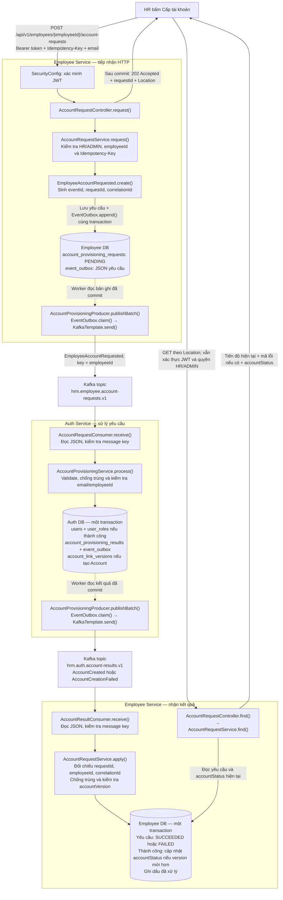

# Employee Service

**Mục lục**

- [Cấu hình và chạy độc lập](#cấu-hình-và-chạy-độc-lập)
- [1. Công nghệ sử dụng](#1-công-nghệ-sử-dụng)
- [2. Cấu trúc project](#2-cấu-trúc-project)
- [3. Database](#3-database)
- [4. Cấu hình application.yaml](#4-cấu-hình-applicationyaml)
- [5. Script SQL](#5-script-sql)
- [6. Các Entity](#6-các-entity)
- [7. Quan hệ Entity](#7-quan-hệ-entity)
- [8. UUID](#8-uuid)
- [9. Chạy project](#9-chạy-project)
- [10. Kiểm tra schema database](#10-kiểm-tra-schema-database)
- [11. Kiểm tra seed data](#11-kiểm-tra-seed-data)
- [12. API](#12-api)
- [13. Thứ tự phát triển đề xuất](#13-thứ-tự-phát-triển-đề-xuất)
- [14. Sử dụng Employee API](#14-sử-dụng-employee-api)
- [15. Health check và kết nối database](#15-health-check-và-kết-nối-database)
- [16. Sử dụng Department API](#16-sử-dụng-department-api)
- [17. Sử dụng Position API](#17-sử-dụng-position-api)
- [18. Xác minh access token từ Auth](#18-xác-minh-access-token-từ-auth)
- [Chạy luồng yêu cầu cấp tài khoản](#chạy-luồng-yêu-cầu-cấp-tài-khoản)

`employee-service` là service quản lý thông tin nhân viên trong hệ thống HRM.

Employee là nguồn dữ liệu chính về hồ sơ nhân viên. Service đã xác minh JWT của
Auth và đã có luồng Kafka cấp tài khoản (Employee mặc định bật `HRM_EVENTS_ENABLED`; Auth mặc định tắt, cần cấu hình cả hai và chuẩn bị schema/topics). Theo
[thiết kế event-driven](../../../README.md#events), người dùng yêu cầu cấp tài khoản
tại Employee sau khi có `employeeId`; Employee gửi `EmployeeAccountRequested`
để Auth tạo Account và trả kết quả. Tạo hồ sơ vẫn là thao tác độc lập.

---

Chạy native với `.env` theo [hướng dẫn chạy độc lập](../../../README.md#local). Các ví dụ database bên dưới dùng mặc định trong mã nguồn (`5432`); mẫu `.env` hiện dùng `55432` và bản sao public key trong `keys/` của service. Nạp file vào environment trước khi chạy Maven, hoặc chỉnh biến theo database/khóa của máy.

## Cấu hình và chạy độc lập

Project Maven riêng, Java 21, cổng mặc định 8082. Build/chạy từ thư mục
employee-service; không cần chạy Maven ở gốc repository hoặc build service khác.

Điều kiện: PostgreSQL/schema và access public key. Đặt `HRM_EVENTS_ENABLED=false` để chạy `CRUD` không có Kafka; bật lại cùng broker/topics để cấp tài khoản bất đồng bộ.

1. Chuẩn bị database/user riêng và SQL theo phần database trong `README` này.
2. Tạo `.env` từ [.env.example](.env.example) nếu chưa có, rồi sửa host/port,
   mật khẩu, đường dẫn khóa và các cờ tính năng theo môi trường thực tế.
3. Nạp biến vào đúng terminal hoặc Run Configuration của IDE trước khi chạy.

Các lệnh sau dùng Git Bash/Bash, bắt đầu từ gốc repository:

```bash
cd back-end/modules/employee-service
test -f .env || cp .env.example .env
# Sửa và lưu .env trước khi chạy các lệnh tiếp theo.
set -a
source ./.env
set +a
mvn spring-boot:run
```

Maven/Spring Boot không tự đọc .env. IDE cần working directory là project và
biến môi trường riêng; thay `.env` phải nạp lại và restart project đó. Mẫu dùng
bản sao access public key tại `keys/access-public.pem` của chính service, tính
từ working directory của module. Cấp cùng public key của môi trường Auth đang dùng
cho từng service khi triển khai; service không cần thư mục Auth trên cùng máy.

| Biến môi trường | Cấu hình cho project này |
| --- | --- |
| `SERVER_PORT` | 8082 |
| `SPRING_DATASOURCE_URL` | jdbc:postgresql://localhost:5432/employee_db; sửa port nếu DB dùng 55432 hoặc port khác |
| `SPRING_DATASOURCE_USERNAME` | employee_user |
| `SPRING_DATASOURCE_PASSWORD` | Mật khẩu của user database này |
| `JWT_ACCESS_PUBLIC_KEY` | file:/duong-dan-tuyet-doi/access-public.pem |
| `JWT_ACCESS_ISSUER` / `JWT_ACCESS_AUDIENCE` | auth-service / hrm-api-access, khớp Auth |

Chỉ cần access public key của Auth; không cấp private key cho project này.

`SPRING_DATASOURCE_*` ưu tiên hơn biến `<SERVICE>_DB_*`; `SERVER_PORT` ưu tiên hơn
biến cổng riêng nếu có. Không giữ hai bộ giá trị mâu thuẫn trong environment.
Dừng bằng `Ctrl+C` trong terminal này. Build riêng bằng `mvn package`; kiểm thử theo
phần kiểm thử bên dưới. Với backend có wrapper có thể dùng `./mvnw` hoặc `mvnw.cmd`
thay mvn. Không bắt buộc `run-all.sh` hoặc Docker Compose để chạy project.

## 1. Công nghệ sử dụng

Quyền truy cập nhân sự được kiểm tra ở cả UI và API:

- `HR`/`ADMIN`: xem danh sách, xem hồ sơ, tạo/sửa nhân viên và quản lý phòng ban/chức danh.
- `EMPLOYEE`/`MANAGER`: chỉ đọc hồ sơ có ID khớp claim `employee_id` trong JWT qua
  `GET /api/v1/employees/{id}`; không được liệt kê nhân viên hoặc sửa hồ sơ, kể cả hồ sơ của mình.
  Trên UI dùng **Hồ sơ của tôi**; các trang quản lý nhân sự bị chặn cả khi nhập URL trực tiếp.
- Endpoint health-check công khai khi gọi trực tiếp; qua Gateway cần access token. Chấm công/nghỉ phép cá nhân tiếp tục đọc hồ sơ
  của chính người gọi bằng JWT hiện tại.

- Java 21
- Spring Boot
- Spring Web
- Spring Data JPA
- PostgreSQL
- Validation
- Lombok
- Maven

---

## 2. Cấu trúc project

```text
employee-service/
├── docs/sql/
│   ├── 001_employee_schema.sql
│   ├── 002_employee_seed.sql
│   └── 003_employee_code_sequence.sql
├── src/
│   └── main/
│       ├── java/
│       │   └── com/company/employee/
│       │       ├── controller/
│       │       ├── service/
│       │       ├── repository/
│       │       ├── dto/
│       │       ├── entity/
│       │       │   ├── AuditableEntity.java
│       │       │   ├── Employee.java
│       │       │   ├── Department.java
│       │       │   └── Position.java
│       │       ├── enums/
│       │       │   └── EmployeeStatus.java
│       │       └── exception/
│       │
│       └── resources/
│           ├── application.yaml
│           └── static/
│               └── openapi/
│                   └── employee-api.yml
│
└── pom.xml
```

---

`Employee`, `Department` và `Position` kế thừa `AuditableEntity` (`@MappedSuperclass`).
Spring Data JPA Auditing điền `createdAt`/`updatedAt` dạng UTC `Instant` và
`createdBy`/`updatedBy` dạng UUID lấy từ claim `employee_id` của JWT. Các thao tác
SQL trực tiếp dùng timestamp mặc định của database; actor có thể null.
`@SuperBuilder` hỗ trợ các trường kế thừa; `Employee` dùng `@DynamicUpdate` để sửa
hồ sơ không ghi đè trạng thái tài khoản vừa được cập nhật qua event.

Bảy bảng thường trực đều có entity: `Department`, `Position`, `Employee`,
`AccountProvisioningRequest`, `ProvisioningProcessedEvent`, `EmployeeAccountVersion`
và `OutboxEvent`. Các bảng tạm `employee_demo_*` chỉ phục vụ seed, không phải entity.
Luồng provisioning/outbox tiếp tục dùng JDBC cho khóa hàng, idempotency và claim/lease;
entity mới cho phép Hibernate kiểm tra mapping của các bảng này khi khởi động.
`EmployeeAccountVersion.version` là version từ Auth, không dùng `@Version` của JPA.

## 3. Database

Service sử dụng database riêng:

```text
employee_db
```

User PostgreSQL:

```text
employee_user
```

### Tạo PostgreSQL user và database

Đăng nhập PostgreSQL bằng user có quyền admin:

```bash
psql -h localhost -U postgres
```

Chỉ tạo user/database nếu chưa tồn tại. Chạy `CREATE DATABASE` ngoài transaction.

Tạo user:

```sql
CREATE USER employee_user
WITH PASSWORD 'employee_password';
```

Tạo database:

```sql
CREATE DATABASE employee_db
OWNER employee_user;
```

Kiểm tra:

```sql
\du
\l
```

Thoát:

```sql
\q
```

Thử đăng nhập bằng user vừa tạo:

```bash
psql -h localhost -U employee_user -d employee_db
```

---

## 4. Cấu hình application.yaml

Ví dụ:

```yaml
server:
  port: 8082

spring:
  application:
    name: employee-service

  datasource:
    url: jdbc:postgresql://localhost:5432/employee_db
    username: employee_user
    password: employee_password

  jpa:
    hibernate:
      ddl-auto: validate
    open-in-view: false
    properties:
      hibernate:
        format_sql: true
```

`ddl-auto: validate` kiểm tra schema khi khởi động. Cần tạo bảng bằng SQL trước;
ứng dụng không tự tạo hoặc cập nhật schema.

---

## 5. Script SQL

Chạy theo thứ tự: [001_employee_schema.sql](docs/sql/001_employee_schema.sql) →
[002_employee_seed.sql](docs/sql/002_employee_seed.sql) (seed chỉ dành cho local development).

Database đã tồn tại cần chạy [003_employee_code_sequence.sql](docs/sql/003_employee_code_sequence.sql)
trước khi triển khai phiên bản tự cấp mã nhân viên:

```bash
psql -X -h localhost -U employee_user -d employee_db -v ON_ERROR_STOP=1 -f docs/sql/003_employee_code_sequence.sql
```

Script chỉ tạo sequence nếu chưa có; không đổi mã hoặc dữ liệu nhân viên cũ.
Database mới dùng `001_employee_schema.sql` đã có sequence này. Mã mới có tiền tố
`EMP` và phần số tối thiểu 6 chữ số. Sequence cấp số riêng cho các request đồng thời,
kể cả khi chạy nhiều instance; backend bỏ qua mã đã tồn tại từ dữ liệu cũ.
Không reset sequence khi khởi động lại hoặc xóa nhân viên. Số có thể bị khuyết nếu
transaction thất bại, đây là hành vi bình thường.

Các file nằm trong `docs/sql`, không đóng gói vào tài nguyên static của ứng dụng.

Schema đầy đủ gồm 7 bảng:

| Bảng | Mục đích |
|---|---|
| `departments` | Phòng ban |
| `positions` | Chức danh |
| `employees` | Hồ sơ, trạng thái lao động và trạng thái tài khoản từ Auth |
| `account_provisioning_requests` | Yêu cầu cấp tài khoản và idempotency key |
| `provisioning_processed_events` | Chống xử lý sự kiện trùng |
| `employee_account_versions` | Version trạng thái tài khoản đã nhận |
| `event_outbox` | Sự kiện chờ gửi Kafka, retry và claim/lease |

`employees.department_id`, `position_id`, `manager_id` tham chiếu phòng ban,
chức danh và nhân viên quản lý. Không cho nhân viên tự quản lý chính mình.

Trong giai đoạn phát triển, hai file nền tảng là: `001_employee_schema.sql` chứa
toàn bộ cấu trúc hiện tại và `002_employee_seed.sql` chứa dữ liệu mẫu. Khi entity
thay đổi, cập nhật trực tiếp hai file này.

Schema dùng `IF NOT EXISTS`, có thể chạy lại để tạo bảng/index còn thiếu nhưng
không cập nhật cấu trúc bảng đã tồn tại. Nếu database phát triển đang dùng schema
cũ, tạo lại database `employee_db` rỗng rồi chạy schema → seed; dữ liệu cũ sẽ bị
xóa khi tạo lại database. Hibernate dùng `ddl-auto: validate`, SQL không tự chạy
khi service khởi động.

API hồ sơ nhận/trả `personalEmail` và bắt buộc `gender`; client cũ cần cập nhật
payload. Endpoint yêu cầu cấp tài khoản vẫn nhận `email` đăng nhập.

Seed tạo **4 phòng ban, 5 chức danh, 7 nhân viên**, với các UUID cũ giữ nguyên để khớp
[seed Auth](../auth-service-main/docs/sql/002_auth_seed.sql):

| Mã | Email hồ sơ Employee | Email đăng nhập trong seed Auth | Role Auth |
|---|---|---|---|
| EMP001 | an.nguyen@company.com | hr@company.com | EMPLOYEE, HR |
| EMP002 | binh.tran@company.com | manager@company.com | EMPLOYEE, MANAGER |
| EMP003 | chi.le@company.com | employee@company.com | EMPLOYEE |
| EMP004 | dung.pham@company.com | Chưa tạo | — |
| EMP005 | ha.vo@company.com | admin@company.com | EMPLOYEE, ADMIN |
| EMP006 | khanh.do@company.com | disabled@company.com (inactive) | EMPLOYEE |
| EMP007 | minhanh.nguyen@example.com | Chưa tạo | — |

EMP003, EMP004 và EMP007 có quản lý trực tiếp là EMP002. EMP004 đang thử việc; các hồ sơ
còn lại có trạng thái lao động `ACTIVE`. Trạng thái lao động độc lập với tài khoản.

Tất cả **EMP001–EMP007** có họ tên, email, số điện thoại, ngày sinh, giới tính,
địa chỉ, người/số điện thoại liên hệ khẩn cấp, ngày vào làm, trạng thái lao động,
phòng ban và chức danh. Đây là dữ liệu giả lập. Quan hệ quản lý giữ nguyên như
trên; `manager_id` có thể trống khi nhân viên chưa có quản lý trực tiếp trong bộ mẫu.
EMP007 — **Nguyễn Minh Anh** thuộc phòng IT, chức danh Software Engineer.
Seed này tạo hồ sơ Employee, không tạo tài khoản đăng nhập, ca làm,
chấm công hoặc đơn nghỉ phép. Các trường thời gian tạo/cập nhật dùng mặc định
của database; không giả lập người thực hiện thay đổi.

Email hồ sơ và email đăng nhập là hai trường riêng, liên kết hai service bằng UUID
`employeeId`. Role và mật khẩu thuộc Auth; chạy Employee seed không tạo tài khoản.
Mọi hồ sơ mới trong seed đều có `employee_account_status=NOT_CREATED`: seed trực tiếp không
phát sự kiện, nên dù đã chạy seed Auth, trạng thái tại Employee vẫn chưa đồng bộ.
EMP004 được chừa để thử luồng cấp tài khoản → email kích hoạt → `ACTIVE` thực tế.

Seed chạy trong một transaction. Chạy lại thêm bản ghi thiếu và bổ sung địa chỉ,
người/số điện thoại liên hệ khẩn cấp đang `NULL`, rỗng hoặc chỉ có khoảng trắng
cho các hồ sơ mẫu cũ. Giới tính mặc định `OTHER` chỉ được thay khi hồ sơ chưa từng
được sửa (`updated_at = created_at`); giá trị `OTHER` trên hồ sơ đã sửa được giữ lại.
Các giá trị đã nhập, trạng thái lao động/tài khoản và version hiện có được giữ nguyên.
Chạy lại sau khi bổ sung không thay đổi dữ liệu hoặc thời gian cập nhật.
Nếu ID/mã/email xung đột với bản ghi khác, toàn bộ
seed thất bại; không tự gán lại liên kết. Các bảng tạm `employee_demo_*` tự xóa khi
commit. Không seed yêu cầu cấp tài khoản, version sự kiện hoặc Outbox.

---

## 6. Các Entity

Tất cả entity hiện tại có thể đặt chung trong:

```text
com.company.employee.entity
```

### Employee

Đại diện cho bảng:

```text
employees
```

Một số field chính:

```text
id
employeeCode
firstName
lastName
personalEmail
accountStatus
phone
dateOfBirth
gender
address
contactRelative
contactRelativePhone
hireDate
status
department
position
manager
createdAt
updatedAt
```

### Department

Đại diện cho bảng:

```text
departments
```

Ví dụ:

```text
HR
IT
FIN
SALES
```

### Position

Đại diện cho bảng:

```text
positions
```

Ví dụ:

```text
HR_MANAGER
SOFTWARE_ENGINEER
TEAM_LEAD
ACCOUNTANT
SALES_EXECUTIVE
```

### EmployeeStatus

```java
public enum EmployeeStatus {
    ACTIVE,
    INACTIVE,
    PROBATION,
    SUSPENDED,
    TERMINATED
}
```

---

## 7. Quan hệ Entity

Trong `Employee`:

```java
@ManyToOne(fetch = FetchType.LAZY)
@JoinColumn(name = "department_id")
private Department department;
```

```java
@ManyToOne(fetch = FetchType.LAZY)
@JoinColumn(name = "position_id")
private Position position;
```

```java
@ManyToOne(fetch = FetchType.LAZY)
@JoinColumn(name = "manager_id")
private Employee manager;
```

Tương ứng database:

```text
Employee
├── Department
├── Position
└── Manager -> Employee
```

---

## 8. UUID

Entity sử dụng:

```java
@Id
@GeneratedValue(strategy = GenerationType.UUID)
private UUID id;
```

Khi insert thông qua JPA/Hibernate, UUID sẽ được sinh từ application.

Nếu database cũng đang có:

```sql
DEFAULT gen_random_uuid()
```

thì PostgreSQL vẫn có thể tự sinh UUID khi insert trực tiếp bằng SQL.

Có thể giữ cả hai trong giai đoạn phát triển, nhưng về lâu dài nên chọn một nơi chịu trách nhiệm sinh UUID.

---

## 9. Chạy project

Sau khi tạo user/database ở mục 3, chạy từ thư mục gốc repository:

```bash
cd back-end/modules/employee-service
psql -X -h localhost -U employee_user -d employee_db -v ON_ERROR_STOP=1 -f docs/sql/001_employee_schema.sql
# Tùy chọn: dữ liệu mẫu local
psql -X -h localhost -U employee_user -d employee_db -v ON_ERROR_STOP=1 -f docs/sql/002_employee_seed.sql
```

Tạo RSA keys của Auth theo [hướng dẫn Auth](../auth-service-main/README.md)
trước khi chạy Employee. Employee chỉ cần access **public** key tương ứng với Auth
đang ký JWT. Từ thư mục `employee-service`, chạy trên Linux/macOS:

```bash
export JWT_ACCESS_PUBLIC_KEY=file:./keys/access-public.pem
export HRM_EVENTS_ENABLED=false
./mvnw spring-boot:run
```

Windows PowerShell (cũng từ thư mục service):

```powershell
$env:JWT_ACCESS_PUBLIC_KEY = "file:./keys/access-public.pem"
$env:HRM_EVENTS_ENABLED = "false"
.\mvnw.cmd spring-boot:run
```

Service mặc định chạy tại `http://localhost:8082`. Có thể dùng
`mvn spring-boot:run` nếu đã cài Maven. `ddl-auto: validate` yêu cầu schema đầy đủ
kể cả khi Kafka đang tắt.

Để thử cấp tài khoản/gửi email, chuẩn bị schema Auth, Kafka topics và cấu hình
activation/Resend của Auth, rồi bật `HRM_EVENTS_ENABLED=true` cho **cả hai service**.
Xem [hướng dẫn Kafka](#provisioning) và
[hướng dẫn kích hoạt](../auth-service-main/README.md#activation).
Dùng EMP004 với email nhận thư thực tế cho yêu cầu thử nghiệm; email demo không
phải hộp thư được cấu hình để nhận email kích hoạt.

---

## 10. Kiểm tra schema database

Sau khi chạy application, kết nối database:

```bash
psql -h localhost -U employee_user -d employee_db
```

Kiểm tra table:

```sql
\dt
```

Kết quả dự kiến có:

```text
departments
employees
positions
account_provisioning_requests
provisioning_processed_events
employee_account_versions
event_outbox
```

---

## 11. Kiểm tra seed data

```sql
SELECT * FROM departments;
```

```sql
SELECT * FROM positions;
```

```sql
SELECT * FROM employees;
```

Có thể join dữ liệu employee:

```sql
SELECT
    e.employee_code,
    e.first_name,
    e.last_name,
    d.name AS department,
    p.name AS position,
    m.employee_code AS manager_code
FROM employees e
LEFT JOIN departments d
    ON e.department_id = d.id
LEFT JOIN positions p
    ON e.position_id = p.id
LEFT JOIN employees m
    ON e.manager_id = m.id;
```

---

## 12. API

Đã triển khai các API Employee:

```text
POST   /api/v1/employees
GET    /api/v1/employees
GET    /api/v1/employees/{id}
PUT    /api/v1/employees/{id}
PATCH  /api/v1/employees/{id}/status
```

Department (đã triển khai):

```text
POST   /api/v1/departments
GET    /api/v1/departments
GET    /api/v1/departments/{id}
PUT    /api/v1/departments/{id}
```

Position (đã triển khai):

```text
POST   /api/v1/positions
GET    /api/v1/positions
GET    /api/v1/positions/{id}
PUT    /api/v1/positions/{id}
```

---

## 13. Thứ tự phát triển đề xuất

```text
1. Database + script SQL tạo schema và dữ liệu mẫu
2. Entity
3. Repository
4. DTO
5. Service
6. Controller
7. Validation
8. Exception Handler
9. Test CRUD
10. Kết nối auth-service
```

Employee đã tích hợp Spring Security OAuth2 Resource Server để xác minh access
JWT từ Auth bằng public key RS256, không gọi Auth trên mỗi request. Hướng dẫn
cấu hình khóa và gọi API nằm ở mục 18 bên dưới. Phân quyền theo role/phạm vi dữ
liệu, kiểm tra `accountStatus` và thu hồi token chưa được triển khai.

`auth-service` quản lý:

```text
User
Password
Role
JWT
Refresh Token
```

`employee-service` quản lý:

```text
Employee
Department
Position
Manager hierarchy
```

Hai service không dùng chung entity hoặc repository.

---

## 14. Sử dụng Employee API

Base URL: `http://localhost:8082/api/v1/employees`.
Swagger UI: `http://localhost:8082/swagger-ui/index.html`.

### Swagger UI

Sau khi khởi động service bằng `./mvnw spring-boot:run`, mở:

- Swagger UI: [http://localhost:8082/swagger-ui.html](http://localhost:8082/swagger-ui.html)
- OpenAPI YAML: [http://localhost:8082/openapi/employee-api.yml](http://localhost:8082/openapi/employee-api.yml)

Tài liệu API được khai báo riêng trong `src/main/resources/static/openapi/employee-api.yml`.
Swagger UI đọc trực tiếp file này theo cấu hình `springdoc.swagger-ui.url` trong
`application.yaml`. Khi thay đổi API, cập nhật paths, schemas, ví dụ và responses
trong file YAML; không cần annotation Swagger trong controller hoặc DTO.
Endpoint tài liệu tự sinh `/v3/api-docs` đã được tắt.

Trong nhóm **Employees**, chọn API → **Try it out** → nhập path/query/body →
**Execute** để gọi thử. Các request có sẵn ví dụ và thông tin trường bắt buộc.
ID phòng ban, chức danh và quản lý trong ví dụ dùng dữ liệu seed; nếu chưa seed,
hãy bỏ các trường ID tùy chọn hoặc thay bằng ID đang tồn tại.
Các thao tác POST/PUT/PATCH sẽ ghi vào database mà service đang kết nối.

Các API nghiệp vụ bên dưới yêu cầu biến `ACCESS_TOKEN` chứa access token lấy từ
Auth. Trên Swagger, chọn **Authorize** và dán access token (không thêm tiền tố
`Bearer` vào ô nhập). Health-check không cần token.

### Tạo nhân viên

```bash
curl -H "Authorization: Bearer $ACCESS_TOKEN" -i -X POST http://localhost:8082/api/v1/employees \
  -H 'Content-Type: application/json' \
  -d '{
    "firstName": "Minh",
    "lastName": "Nguyen",
    "personalEmail": "minh.nguyen@company.com",
    "gender": "OTHER",
    "phone": "0901000007",
    "dateOfBirth": "1999-05-20",
    "hireDate": "2026-09-01",
    "status": "PROBATION",
    "departmentId": "22222222-2222-2222-2222-222222222222",
    "positionId": "aaaaaaaa-aaaa-aaaa-aaaa-aaaaaaaaaaa2",
    "managerId": "10000000-0000-0000-0000-000000000002"
  }'
```

Các ID trong ví dụ lấy từ `docs/sql/002_employee_seed.sql`.
Trả về `201 Created`, header `Location` và thông tin nhân viên vừa tạo.

- Bắt buộc: `firstName`, `lastName`, `personalEmail`, `gender`, `hireDate`, `status`.
- Tùy chọn: `phone`, `dateOfBirth`, `address`, `contactRelative`, `contactRelativePhone`, `departmentId`, `positionId`, `managerId`.
- `gender`: `MALE`, `FEMALE`, `OTHER`; địa chỉ/tên người thân tối đa 255 ký tự, số điện thoại người thân tối đa 30.
- Backend tự cấp `employeeCode` dạng `EMP000001`, `EMP000002`… bằng sequence `employee_code_seq`. Client không gửi mã khi tạo/sửa; mã gửi từ client bị bỏ qua. Mã đã cấp không thay đổi khi sửa hồ sơ.
- Họ/tên tối đa 100; email tối đa 255; điện thoại tối đa 30.
- Chuỗi được bỏ khoảng trắng ở đầu/cuối. Mã nhân viên phải duy nhất theo phép so sánh của database. `personalEmail` không bắt buộc duy nhất và độc lập với email đăng nhập trong yêu cầu cấp tài khoản.
- Ngày theo định dạng `yyyy-MM-dd`; ngày sinh phải trong quá khứ và trước ngày vào làm.
- `status`: `ACTIVE`, `INACTIVE`, `PROBATION`, `SUSPENDED`, `TERMINATED`.
- Các ID tham chiếu phải tồn tại; không được tự quản lý hoặc tạo vòng lặp quản lý.

Response có các trường thông tin nhân viên, `id`, `employeeCode` do backend cấp, `createdAt`, `updatedAt` và:

```json
{
  "accountStatus": "NOT_CREATED",
  "department": {
    "id": "22222222-2222-2222-2222-222222222222",
    "code": "IT",
    "name": "Information Technology"
  },
  "position": {
    "id": "aaaaaaaa-aaaa-aaaa-aaaa-aaaaaaaaaaa2",
    "code": "SOFTWARE_ENGINEER",
    "name": "Software Engineer"
  },
  "manager": {
    "id": "10000000-0000-0000-0000-000000000002",
    "employeeCode": "EMP002",
    "firstName": "Binh",
    "lastName": "Tran"
  }
}
```

Các quan hệ chưa được gán trả về `null`. Thông tin quản lý chỉ gồm tóm tắt,
không lồng toàn bộ cây quản lý vào response.

`accountStatus` thay cho `hasAccount` trong response, mặc định `NOT_CREATED` cho
nhân viên mới. Client không được đặt trạng thái này qua request tạo/sửa nhân viên.
Employee không lưu `accountId`; Auth giữ liên kết `employeeId` và là nguồn dữ liệu
chính về tài khoản. Trạng thái tại Employee chỉ là bản sao để hiển thị, không dùng
để quyết định quyền truy cập.

| Giá trị | Ý nghĩa |
|---|---|
| `NOT_CREATED` | Chưa có tài khoản theo thông tin hiện biết |
| `PENDING_ACTIVATION` | Đã có tài khoản, chờ đặt mật khẩu/kích hoạt qua email |
| `ACTIVE` | Tài khoản đang hoạt động |
| `SUSPENDED` | Tài khoản tạm đình chỉ |
| `DISABLED` | Tài khoản bị vô hiệu hóa |

Đã nhận `AccountCreated` / `AccountCreationFailed` để hoàn tất yêu cầu cấp tài khoản.
Consumer `AccountStatusChanged` đã nhận trạng thái sau kích hoạt, chỉ áp dụng version mới hơn. Thiết kế nằm trong
[hướng dẫn event-driven](../../../README.md#events). Không thêm `PENDING`/`FAILED` của
quá trình cấp tài khoản vào enum này.

Schema [001_employee_schema.sql](docs/sql/001_employee_schema.sql) dùng
`employee_account_status` mặc định `NOT_CREATED`, không dùng `has_account` hoặc `UNKNOWN`.
Database phát triển dùng schema cũ cần tạo lại theo mục 5. Frontend đọc `accountStatus`
thay cho trường `hasAccount` đã bị loại khỏi response.

### Cấp tài khoản qua sự kiện

```text
UI → Employee: tạo hồ sơ → nhận employeeId
UI → Employee: yêu cầu cấp tài khoản cho employeeId
Employee → yêu cầu PENDING + Outbox → EmployeeAccountRequested → Kafka → Auth
Auth → AccountCreated / AccountCreationFailed → Kafka → Employee → UI đọc kết quả
```

API đã có, chỉ HR/ADMIN toàn hệ thống; cần `HRM_EVENTS_ENABLED=true`:

- `POST /api/v1/employees/{employeeId}/account-requests`: kiểm tra quyền HR/ADMIN,
  phạm vi và nhân viên tồn tại; nhận email đăng nhập, không nhận mật khẩu. Lưu yêu
  cầu + Outbox cùng transaction, trả `202 Accepted`, `requestId` và `PENDING`.
- `GET /api/v1/employees/{employeeId}/account-requests/{requestId}`: truy vấn tiến độ
  có phân quyền. Gửi lại POST do mất phản hồi dùng cùng `Idempotency-Key`; thử lại
  sau thất bại nghiệp vụ là yêu cầu mới.

Worker gọi `AccountProvisioningProducer`, chỉ đánh dấu đã gửi sau Kafka ack. Auth
tạo Account gắn `employeeId`, quản lý role và thiết lập mật khẩu/kích hoạt. Auth
không cần gọi lại Employee chỉ để xác minh ID của yêu cầu từ nguồn được xác thực.
Flow này dùng `EmployeeAccountRequested`; sự kiện vòng đời nhân viên chỉ bổ sung
khi có phân hệ khác cần nhận.

Trạng thái yêu cầu được lưu riêng: `PENDING`, `SUCCEEDED`, `FAILED`; chưa có yêu
cầu thì UI có thể hiển thị `NOT_REQUESTED`. Kết quả phải khớp `requestId` và
`employeeId`. `AccountCreated` hoàn tất yêu cầu và cập nhật `accountStatus` theo
version Auth; thành công có thể vẫn đang `PENDING_ACTIVATION`.
`AccountCreationFailed` chỉ làm yêu cầu thất bại, không xóa hồ sơ hoặc đặt lại
`accountStatus`. Kết quả cũ không ghi đè yêu cầu mới hay trạng thái tài khoản mới hơn.

Không cập nhật trạng thái lao động `EmployeeStatus` bằng kết quả từ Auth. Schema
đã gồm hạ tầng Outbox và yêu cầu cấp tài khoản; Auth đã có API đặt mật khẩu/kích hoạt
và phát sự kiện để Employee cập nhật `ACTIVE`. Xem [hướng dẫn chạy và ví dụ API](#provisioning)
và [lộ trình còn lại](../../../README.md#events-10-lộ-trình-triển-khai-theo-phase).

### Danh sách và chi tiết

```bash
curl -H "Authorization: Bearer $ACCESS_TOKEN" 'http://localhost:8082/api/v1/employees?page=0&size=20'
curl -H "Authorization: Bearer $ACCESS_TOKEN" 'http://localhost:8082/api/v1/employees/10000000-0000-0000-0000-000000000003'
```

Danh sách sắp xếp theo `employeeCode` tăng dần. `page` bắt đầu từ 0 (mặc định 0),
`size` từ 1 đến 100 (mặc định 20). Response gồm `content`, `page`, `size`,
`totalElements`, `totalPages`. API chi tiết trả về một nhân viên.

### Cập nhật và đổi trạng thái

`PUT /api/v1/employees/{id}` dùng cùng body với POST, thay thế toàn bộ thông tin
có thể chỉnh sửa. Phải gửi đủ các trường bắt buộc; trường tùy chọn bị bỏ qua
hoặc gửi `null` sẽ được xóa, bao gồm các quan hệ. `id` và `createdAt` được giữ nguyên.

Để chỉ đổi trạng thái:

```bash
curl -H "Authorization: Bearer $ACCESS_TOKEN" -X PATCH \
  http://localhost:8082/api/v1/employees/10000000-0000-0000-0000-000000000003/status \
  -H 'Content-Type: application/json' \
  -d '{"status":"INACTIVE"}'
```

Cả PUT và PATCH trả về `200 OK` cùng thông tin nhân viên sau cập nhật.

### Lỗi

- `401 Unauthorized`: thiếu/sai access token; response dạng `application/problem+json` và header `WWW-Authenticate: Bearer`.

Response lỗi theo dạng Problem Detail (`status`, `title`, `detail`, `instance`).
Lỗi validation của body có thêm `errors` chứa thông báo theo tên trường.

| HTTP status | Trường hợp |
| --- | --- |
| 400 | Thiếu/sai dữ liệu, UUID/ngày/status không hợp lệ, phân trang sai, vòng lặp quản lý |
| 404 | Nhân viên hoặc department/position/manager được tham chiếu không tồn tại |
| 409 | Trùng mã hoặc xung đột ràng buộc dữ liệu |

### Test

```bash
mvn test
```

Test dùng profile `test` với H2 in-memory ở chế độ PostgreSQL và tự tạo schema
riêng, không yêu cầu hoặc thay đổi database PostgreSQL đang chạy.
Các test bao phủ luồng HTTP tạo/đọc/cập nhật/đổi trạng thái, phân trang,
validation, dữ liệu trùng, tham chiếu và vòng lặp quản lý.

---

## 15. Health check và kết nối database

Service sử dụng Spring Boot Actuator để kiểm tra trạng thái và kết nối database
thực tế qua datasource đang cấu hình:

```bash
curl -i http://localhost:8082/actuator/health
curl -i http://localhost:8082/actuator/health/db
```

- `/actuator/health`: trạng thái tổng thể của service và các thành phần, bao gồm `db`.
- `/actuator/health/db`: chỉ kiểm tra kết nối database.
- HTTP `200` và `status: UP` khi hoạt động bình thường.
- HTTP `503` và `status: DOWN` khi kiểm tra database thất bại; trạng thái tổng thể cũng chuyển sang `DOWN`.

Ví dụ response khi database hoạt động:

```json
{"status":"UP"}
```

Hai endpoint cũng nằm trong nhóm **Health** trên Swagger UI. Cấu hình chỉ mở
endpoint Actuator `health`, hiển thị trạng thái các thành phần và ẩn chi tiết lỗi nội bộ.
Health check dùng connection pool hiện có nên khi mất kết nối, response có thể
phải chờ hết timeout của pool/driver.

Các endpoint có sau khi service khởi động thành công. Nếu database không sẵn sàng
ngay từ lúc khởi động, `ddl-auto: validate` có thể khiến ứng dụng không khởi động được.

---

## 16. Sử dụng Department API

### Tạo phòng ban

```bash
curl -H "Authorization: Bearer $ACCESS_TOKEN" -i -X POST http://localhost:8082/api/v1/departments \
  -H 'Content-Type: application/json' \
  -d '{"code":"IT","name":"Information Technology","description":"Quản lý hệ thống CNTT"}'
```

- Bắt buộc: `code` (tối đa 50 ký tự), `name` (tối đa 150 ký tự); không được chỉ chứa khoảng trắng.
- `description` tùy chọn. Các chuỗi được bỏ khoảng trắng đầu/cuối.
- `code` phải duy nhất, có phân biệt hoa/thường theo schema hiện tại.
- Phòng ban mới có `active=true`; `createdAt` và `updatedAt` được tự điền trong database.

Trả về `201 Created`, header `Location: /api/v1/departments/{id}` và body
gồm `id`, `code`, `name`, `description`.

### Danh sách và chi tiết

```bash
curl -H "Authorization: Bearer $ACCESS_TOKEN" 'http://localhost:8082/api/v1/departments?page=0&size=20'
curl -H "Authorization: Bearer $ACCESS_TOKEN" 'http://localhost:8082/api/v1/departments/22222222-2222-2222-2222-222222222222'
```

Thay UUID bằng `id` phòng ban đang tồn tại. Danh sách sắp xếp theo `code` tăng dần;
`page` bắt đầu từ 0 (mặc định 0), `size` từ 1 đến 100 (mặc định 20).
Response gồm `content`, `page`, `size`, `totalElements`, `totalPages`.
API chi tiết trả về `id`, `code`, `name`, `description`.

### Cập nhật phòng ban

```bash
curl -H "Authorization: Bearer $ACCESS_TOKEN" -i -X PUT http://localhost:8082/api/v1/departments/22222222-2222-2222-2222-222222222222 \
  -H 'Content-Type: application/json' \
  -d '{"code":"IT","name":"Information Technology","description":"Phòng công nghệ thông tin"}'
```

Thay UUID bằng `id` phòng ban đang tồn tại. PUT dùng cùng body và validation với POST,
thay thế `code`, `name`, `description`. Phải gửi đủ `code` và `name`;
`description` bị bỏ qua hoặc gửi `null` sẽ được xóa. Được phép giữ mã hiện tại;
mã trùng với phòng ban khác trả về `409`.

Trả về `200 OK` cùng thông tin phòng ban sau cập nhật. Giữ nguyên `id`, `createdAt`
và `active`; tự cập nhật `updatedAt` khi dữ liệu thay đổi.

Lỗi dùng Problem Detail: `400` khi dữ liệu/UUID/phân trang sai, `404` khi phòng ban
không tồn tại, `409` khi trùng mã hoặc xung đột ràng buộc dữ liệu.
Lỗi validation body có thêm `errors` theo tên trường.

Các API nằm trong nhóm **Departments** trên Swagger UI. Chạy `mvn test` để kiểm tra
luồng tạo/đọc/cập nhật, phân trang, chuẩn hóa chuỗi, validation và trùng mã bằng H2.

---

## 17. Sử dụng Position API

### Tạo chức danh

```bash
curl -H "Authorization: Bearer $ACCESS_TOKEN" -i -X POST http://localhost:8082/api/v1/positions \
  -H 'Content-Type: application/json' \
  -d '{"code":"SOFTWARE_ENGINEER","name":"Software Engineer","description":"Phát triển phần mềm"}'
```

- Bắt buộc: `code` (tối đa 50 ký tự), `name` (tối đa 150 ký tự); không được chỉ chứa khoảng trắng.
- `description` tùy chọn. Các chuỗi được bỏ khoảng trắng đầu/cuối.
- `code` phải duy nhất, có phân biệt hoa/thường theo schema hiện tại.
- Chức danh mới có `active=true`; `createdAt` và `updatedAt` được tự điền trong database.

Trả về `201 Created`, header `Location: /api/v1/positions/{id}` và body
gồm `id`, `code`, `name`, `description`.

### Danh sách và chi tiết

```bash
curl -H "Authorization: Bearer $ACCESS_TOKEN" 'http://localhost:8082/api/v1/positions?page=0&size=20'
curl -H "Authorization: Bearer $ACCESS_TOKEN" 'http://localhost:8082/api/v1/positions/aaaaaaaa-aaaa-aaaa-aaaa-aaaaaaaaaaa2'
```

Thay UUID bằng `id` chức danh đang tồn tại. Danh sách sắp xếp theo `code` tăng dần;
`page` bắt đầu từ 0 (mặc định 0), `size` từ 1 đến 100 (mặc định 20).
Response gồm `content`, `page`, `size`, `totalElements`, `totalPages`.
API chi tiết trả về `id`, `code`, `name`, `description`.

### Cập nhật chức danh

```bash
curl -H "Authorization: Bearer $ACCESS_TOKEN" -i -X PUT http://localhost:8082/api/v1/positions/aaaaaaaa-aaaa-aaaa-aaaa-aaaaaaaaaaa2 \
  -H 'Content-Type: application/json' \
  -d '{"code":"SOFTWARE_ENGINEER","name":"Software Engineer","description":"Kỹ sư phần mềm"}'
```

Thay UUID bằng `id` chức danh đang tồn tại. PUT dùng cùng body và validation với POST,
thay thế `code`, `name`, `description`. Phải gửi đủ `code` và `name`;
`description` bị bỏ qua hoặc gửi `null` sẽ được xóa. Được phép giữ mã hiện tại;
mã trùng với chức danh khác trả về `409`.

Trả về `200 OK` cùng thông tin chức danh sau cập nhật. Giữ nguyên `id`, `createdAt`
và `active`; tự cập nhật `updatedAt` khi dữ liệu thay đổi.

Lỗi dùng Problem Detail: `400` khi dữ liệu/UUID/phân trang sai, `404` khi chức danh
không tồn tại, `409` khi trùng mã hoặc xung đột ràng buộc dữ liệu.
Lỗi validation body có thêm `errors` theo tên trường.

Các API nằm trong nhóm **Positions** trên Swagger UI. Chạy `mvn test` để kiểm tra
luồng tạo/đọc/cập nhật, phân trang, chuẩn hóa chuỗi, validation và trùng mã bằng H2.

## 18. Xác minh access token từ Auth

Employee dùng Spring Security OAuth2 Resource Server và `NimbusJwtDecoder`.
Chỉ chấp nhận access token RS256 có chữ ký đúng với access public key đã cấu hình,
`iss=auth-service`, `aud` chứa `hrm-api-access`, `exp` bắt buộc còn hạn và `nbf`
(nếu có) đã đến. Kiểm tra thời gian không có khoảng dung sai; đồng bộ đồng hồ
các máy triển khai.

Hợp đồng claim khớp Auth hiện tại: `sub` là ID tài khoản không rỗng,
`employee_id` là UUID, `roles` là mảng chuỗi không rỗng. Claim `type` có thể vắng
mặt như access token hiện tại hoặc bằng `access`; giá trị `refresh` bị từ chối.
Refresh token của Auth còn dùng cặp khóa và audience riêng nên không dùng để
truy cập Employee được.

### Public key và khởi động

Employee chỉ cần **access public key** của Auth, định dạng PEM X.509
(`BEGIN PUBLIC KEY`), RSA từ 2048 bit. Không sao chép private key hoặc dùng refresh
public key. Cách tạo khóa tại Auth nằm trong
[hướng dẫn asymmetric JWT](../auth-service-main/README.md#jwt).

Đặt bản sao access public key của môi trường Auth vào `employee-service/keys/access-public.pem`,
rồi chạy từ thư mục `employee-service`:

```bash
export JWT_ACCESS_PUBLIC_KEY=file:./keys/access-public.pem
./mvnw spring-boot:run
```

Mặc định Employee đọc bản sao public key tại `./keys/access-public.pem` của chính nó.
Thư mục `keys/` được bỏ qua trong Git. Trong production,
mount public key vào Employee và đặt biến môi trường theo đường dẫn thực tế.

| Biến môi trường | Mặc định |
|---|---|
| `JWT_ACCESS_PUBLIC_KEY` | `file:./keys/access-public.pem` |
| `JWT_ACCESS_ISSUER` | `auth-service` |
| `JWT_ACCESS_AUDIENCE` | `hrm-api-access` |

Service báo lỗi khi khởi động nếu thiếu/sai public key, khóa quá ngắn hoặc
issuer/audience để trống. Khóa được nạp lúc khởi động; khi Auth đổi khóa ký, phải
cập nhật public key và khởi động lại Employee. Chưa hỗ trợ JWKS hoặc xoay nhiều
khóa theo `kid`.

### Gọi API

Đăng nhập ở `POST /api/v1/auth/login` của Auth, lấy trường `data.accessToken`, rồi đặt
vào biến `ACCESS_TOKEN` trong môi trường thử nghiệm. Employee nhận token qua
header, không nhận qua query parameter hoặc cookie:

```bash
curl -i http://localhost:8082/api/v1/employees \
  -H "Authorization: Bearer $ACCESS_TOKEN"
```

Các API `/api/v1/**` yêu cầu xác thực, ngoại trừ GET
`/api/v1/employees/health-check`. GET `/actuator/health`, `/actuator/health/**`,
`/swagger-ui.html`, `/swagger-ui/**`, `/v3/api-docs/swagger-config` và
`/openapi/employee-api.yml` cũng công khai.
Đường dẫn khác bị từ chối; SQL nằm trong `docs/sql`, không cung cấp qua HTTP.
Nếu gửi token sai ngay cả tới đường dẫn công khai, bộ lọc Bearer vẫn trả `401`.

Cấu hình stateless, không lưu phiên đăng nhập, không hỗ trợ Basic/form login.
CSRF bị tắt vì xác thực qua Bearer header, không dùng cookie tự gửi của trình duyệt.

### Phạm vi bảo vệ hiện tại

Các role trong token được ánh xạ thành `ROLE_EMPLOYEE`, `ROLE_HR`, ... trong
SecurityContext; principal là `sub` của token. API yêu cầu cấp tài khoản cần role
HR hoặc ADMIN. Các API quản lý hồ sơ/phòng ban/chức danh cũng yêu cầu HR/ADMIN.
Người dùng khác chỉ đọc hồ sơ có ID khớp claim `employee_id`; không có quyền liệt kê hoặc sửa.

`accountStatus` được đồng bộ qua Kafka nhưng chỉ dùng để hiển thị, không kiểm tra
trong bộ lọc. JWT còn hạn có thể tiếp tục dùng sau khi tài khoản bị khóa ở Auth.
Phân quyền dữ liệu hiện kiểm tra tại controller; cơ chế thu hồi tức thời access JWT ở các resource service chưa có.

### Kiểm thử

Chạy `./mvnw test`. Bộ kiểm thử security tạo cặp RSA tạm thời và gửi JWT ký thật
qua HTTP filter, không cần Auth hay PostgreSQL đang chạy. Bao gồm token hợp lệ,
chữ ký giả, payload bị sửa, thuật toán khác RS256, issuer/audience sai, hết hạn,
`nbf` trong tương lai, thiếu claim, refresh token, đường dẫn công khai và phiên
stateless. Các test CRUD dùng người dùng giả lập riêng để kiểm tra nghiệp vụ.

Tham khảo: [Spring Security Resource Server JWT](https://docs.spring.io/spring-security/reference/servlet/oauth2/resource-server/jwt.html).

<a id="provisioning"></a>

## Chạy luồng yêu cầu cấp tài khoản

Đã có hai chiều: Employee nhận yêu cầu → Outbox → Kafka → Auth tạo Account hoặc
trả lỗi → Outbox → Kafka → Employee cập nhật kết quả. Tạo hồ sơ không tự cấp Account.

Account tạo qua luồng này có `activation_pending=true`, `is_active=false`, role
`EMPLOYEE`, hash từ bí mật ngẫu nhiên riêng từng tài khoản không được giữ lại hoặc
phát ra ngoài. Đã có [email Resend, token hết hạn và API đặt mật khẩu/kích hoạt](../auth-service-main/README.md#activation).
Tài khoản mới chỉ đăng nhập được sau khi hoàn tất kích hoạt. Không bật thủ công `is_active` hoặc dùng mật khẩu chung để
thay thế luồng kích hoạt; database không cho Account chờ kích hoạt trở thành active.

<a id="provisioning-1-database-và-kafka"></a>

### 1. Database và Kafka

Chạy từ `back-end/modules`, sau khi tạo user/database development riêng cho Employee và Auth:

```bash
psql -X -v ON_ERROR_STOP=1 -h localhost -U employee_user -d employee_db \
  -f employee-service/docs/sql/001_employee_schema.sql
psql -X -v ON_ERROR_STOP=1 -h localhost -U auth_user -d auth_db \
  -f auth-service-main/docs/sql/001_auth_schema.sql

docker compose -f infra/kafka/compose.yaml up -d
docker compose -f infra/kafka/compose.yaml run --rm kafka-init
```

Hai service dùng schema đầy đủ trong `docs/sql/001_employee_schema.sql` và
`docs/sql/001_auth_schema.sql`; SQL không tự chạy khi ứng dụng start.
Các script tạo bảng/index còn thiếu, không reset database và không tự ALTER
bảng cũ. Database Employee còn `has_account`/`UNKNOWN` hoặc thiếu cột/constraint
cần migration riêng sau khi đối chiếu schema; Auth cũ cũng cần kiểm tra tương tự.

Dữ liệu mẫu local là tùy chọn: chạy `employee-service/docs/sql/002_employee_seed.sql`
và `auth-service-main/docs/sql/002_auth_seed.sql` sau schema tương ứng.
UUID nhân viên khớp giữa hai seed. Seed không phát sự kiện nên `accountStatus`
tại Employee chưa phản ánh các tài khoản seed Auth; dùng EMP004 chưa có Account
để thử toàn bộ luồng này. Xem [hướng dẫn Employee](#5-script-sql).

Topic yêu cầu: `hrm.employee.account-requests.v1`; topic kết quả:
`hrm.auth.account-results.v1`. Sau kích hoạt, Auth phát `AccountStatusChanged` qua
`hrm.auth.account-lifecycle.v1`, Employee consumer cập nhật theo version.

<a id="provisioning-2-chạy-hai-service"></a>

### 2. Chạy hai service

Từ thư mục từng service, dùng cấu hình database và JWT như trước:

```bash
HRM_EVENTS_ENABLED=true ./mvnw spring-boot:run
```

`KAFKA_BOOTSTRAP_SERVERS` mặc định `localhost:9092`. `HRM_EVENTS_ENABLED` mặc định `false` ở Auth, `true` ở Employee; đặt rõ ở cả hai tiến trình:
worker/listener không chạy và API yêu cầu trả `503`. Khi bật cờ ở Auth, API
`POST /api/v1/auth/register` cũ trả `409`; các thao tác login/refresh hiện có vẫn
hoạt động cho Account đã active. Việc này ngăn đường tạo Account bỏ qua Outbox.

Dùng tài khoản HR/ADMIN đã có để đăng nhập; Auth seed local vẫn dùng được. JWT
Employee phải xác minh được bằng access public key của Auth. Hai API mới cho
HR/ADMIN toàn hệ thống; chưa có phạm vi theo phòng ban hoặc tenant.

<a id="provisioning-3-gửi-yêu-cầu"></a>

### 3. Gửi yêu cầu

Tạo nhân viên qua API Employee như trước rồi dùng ID vừa nhận. Thay các biến dưới
bằng dữ liệu local của bạn; key phải là UUID mới cho thao tác cấp tài khoản mới.

```bash
curl -i -X POST "http://localhost:8082/api/v1/employees/$EMPLOYEE_ID/account-requests" \
  -H "Authorization: Bearer $ACCESS_TOKEN" \
  -H "Idempotency-Key: $IDEMPOTENCY_KEY" \
  -H 'Content-Type: application/json' \
  -d '{"email":"employee@example.com"}'
```

Phản hồi `202 Accepted`, header `Location` và body:

```json
{
  "requestId": "ad96c1d8-d0d9-477c-a47b-7aed14d46db1",
  "employeeId": "d38e31b7-0bba-420c-8eaf-50edbe5a61ae",
  "provisioningStatus": "PENDING",
  "errorCode": null,
  "accountStatus": "NOT_CREATED",
  "createdAt": "2026-09-28T03:00:00Z"
}
```

Gửi lại cùng key/người gọi và email/nhân viên sẽ nhận cùng `requestId`; đổi dữ liệu
với key cũ hoặc gửi yêu cầu mới khi còn `PENDING` trả `409`. Backend chuẩn hóa email
bằng strip và lowercase. Không truyền mật khẩu, role hoặc `requestedBy`; server
lấy người yêu cầu từ principal JWT và Auth tự gán role `EMPLOYEE`.

Đọc tiến độ qua `Location` hoặc:

```bash
curl "http://localhost:8082/api/v1/employees/$EMPLOYEE_ID/account-requests/$REQUEST_ID" \
  -H "Authorization: Bearer $ACCESS_TOKEN"
```

- Thành công: `SUCCEEDED`, `accountStatus=PENDING_ACTIVATION`.
- Email đã dùng: `FAILED`, `errorCode=EMAIL_ALREADY_USED`.
- Nhân viên đã có Account: `FAILED`, `errorCode=ACCOUNT_ALREADY_EXISTS`.
- Auth/Kafka gián đoạn: vẫn `PENDING`; Outbox/consumer retry. Không tạo lại yêu cầu
  hoặc kết luận Account chưa tồn tại chỉ vì chưa thấy kết quả.

Thất bại nghiệp vụ không xóa Employee hoặc đổi `accountStatus`. Sau khi sửa dữ liệu,
gửi yêu cầu mới với key mới. Kết quả khớp request/employee/correlation ID; version
cũ không ghi đè bản sao Account mới hơn. API sửa hồ sơ dùng dynamic update để không
ghi đè trạng thái tài khoản vừa cập nhật bởi consumer.

<a id="provisioning-4-kiểm-thử-và-giới-hạn"></a>

### 4. Kiểm thử và giới hạn

Các test mới tập trung vào service và worker: idempotency, phân quyền, rollback,
unique conflict, gửi trùng, version cũ, claim hết hạn và Kafka gửi lỗi. Giữ bộ test
hiện có; không thêm test controller cho luồng này. `KafkaConnectionTests` opt-in
kiểm tra topic yêu cầu/kết quả mới bằng cấu hình thật của từng service.

Outbox claim từng bản ghi trong transaction ngắn, lease 2 phút; gửi ngoài transaction,
chỉ đánh dấu đã gửi sau ack. Retry có backoff, tối đa 5 phút giữa hai lần; delivery
có thể trùng. Consumer hiện retry vô hạn với khoảng chờ 5 giây, không bỏ qua message
lỗi. **Chưa có DLT**, nên payload lỗi có thể chặn partition: cần kiểm tra log/Outbox
và triển khai DLT/đối soát trước production. Không xóa/reset offset tùy tiện.

Đã có kích hoạt/đặt mật khẩu và consumer `AccountStatusChanged` sau kích hoạt.
Còn thiếu: API khóa/mở tài khoản và phát sự kiện tương ứng,
đối soát dữ liệu cũ/yêu cầu treo, metric/cảnh báo, DLT và TLS/SASL/ACL production.
`producer` trong JSON và key Kafka không thay thế xác thực broker. Kafka local
PLAINTEXT chỉ dành cho phát triển; không coi đây là bản production hoàn chỉnh.

<a id="provisioning-5-sơ-đồ-từ-thao-tác-ui-đến-kết-quả"></a>

### 5. Sơ đồ từ thao tác UI đến kết quả

UI gửi **HTTP request** tới Employee; `EmployeeAccountRequested` được backend tạo
sau khi kiểm tra quyền và nhân viên. Sơ đồ giả định đã bật cờ sự kiện, cấu hình
topic và chạy schema đầy đủ. Đây là luồng cho một yêu cầu mới hợp lệ.



Hai hình Employee DB biểu diễn **cùng một database**, tại hai thời điểm xử lý khác
nhau. `202` được trả sau khi Employee commit yêu cầu, không chờ Kafka hoặc Auth.
Worker có thể gửi ngay sau commit; không có cam kết về thứ tự giữa việc UI nhận
HTTP response và việc Auth bắt đầu xử lý.

Chi tiết worker ở cả hai service:

```text
@Scheduled gọi publishBatch()
    → EventOutbox.claim(): transaction ngắn, giữ quyền xử lý bằng lease
    → KafkaTemplate.send(): gửi ngoài transaction database
        ├─ Broker xác nhận → EventOutbox.sent(): ghi sent_at
        └─ Lỗi/timeout → EventOutbox.retry(): hẹn lần gửi tiếp theo
```

Consumer gọi service để hoàn tất transaction trước khi listener trả về; cấu hình
ack theo record cho phép commit offset sau đó. Lỗi được ném ra để retry, không tự
chuyển thành thành công. `ProvisioningKafkaConfig` bật scheduling và cấu hình xử lý
lỗi Kafka; nó không phải một API hoặc nơi tạo Account.

Auth không nhận HTTP request trực tiếp trong flow này. Notification nhận kết quả
Auth bằng consumer group riêng, dùng `data.requestedBy` để phát SSE đúng HR/Admin
đã yêu cầu. UI nhận SSE rồi xác nhận bằng GET tại Employee; nếu kết quả chưa về,
GET vẫn trả `PENDING` và UI tiếp tục polling dự phòng, kể cả khi đã chuyển trang.
Xem [cấu hình Notification và schema bổ sung](../notification-service/README.md).
Khi thành công, yêu cầu là `SUCCEEDED`, còn Account đang `PENDING_ACTIVATION`.
