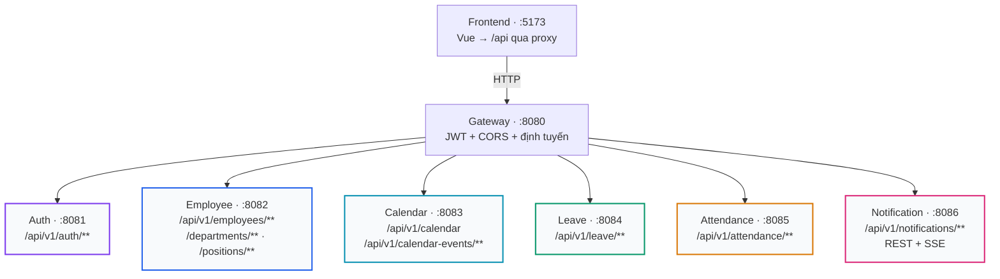
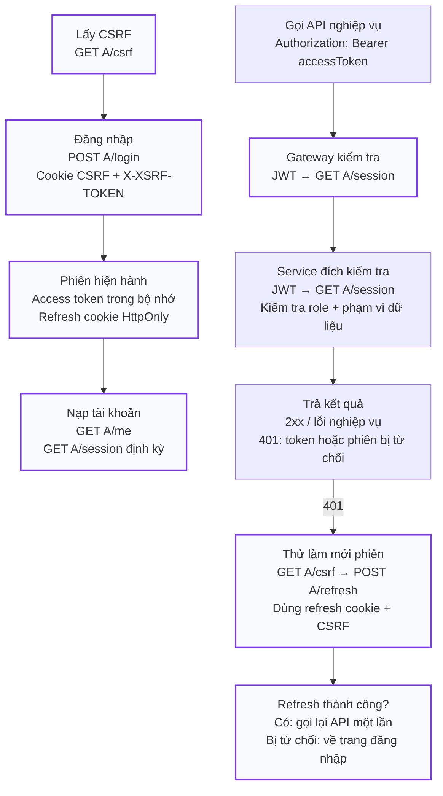
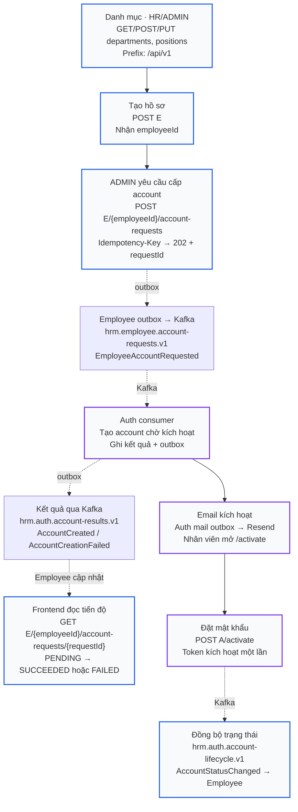
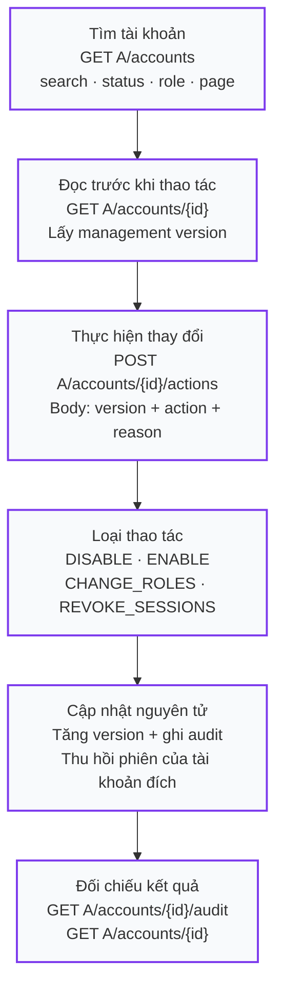
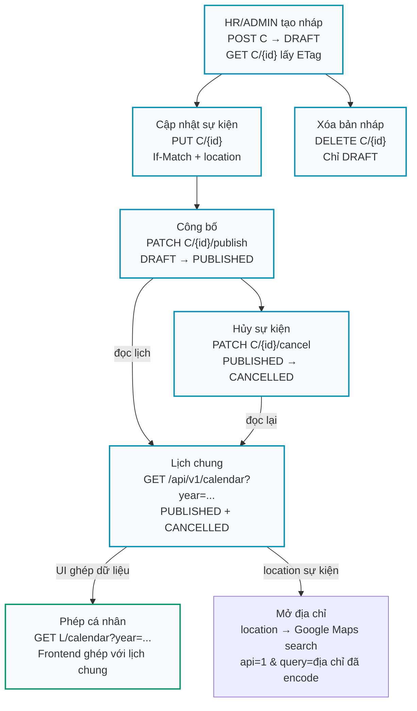
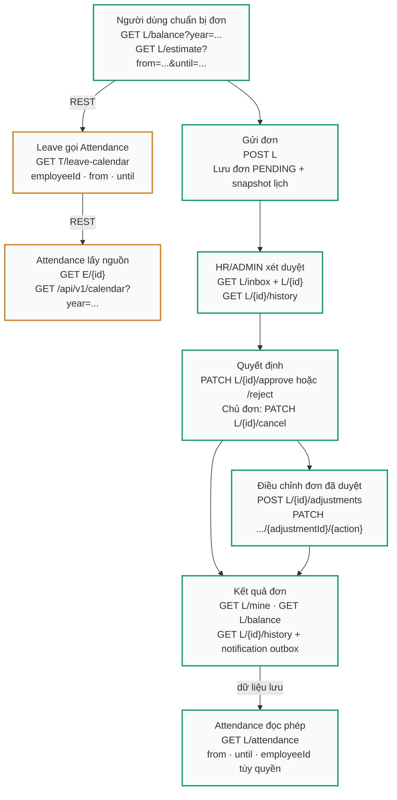
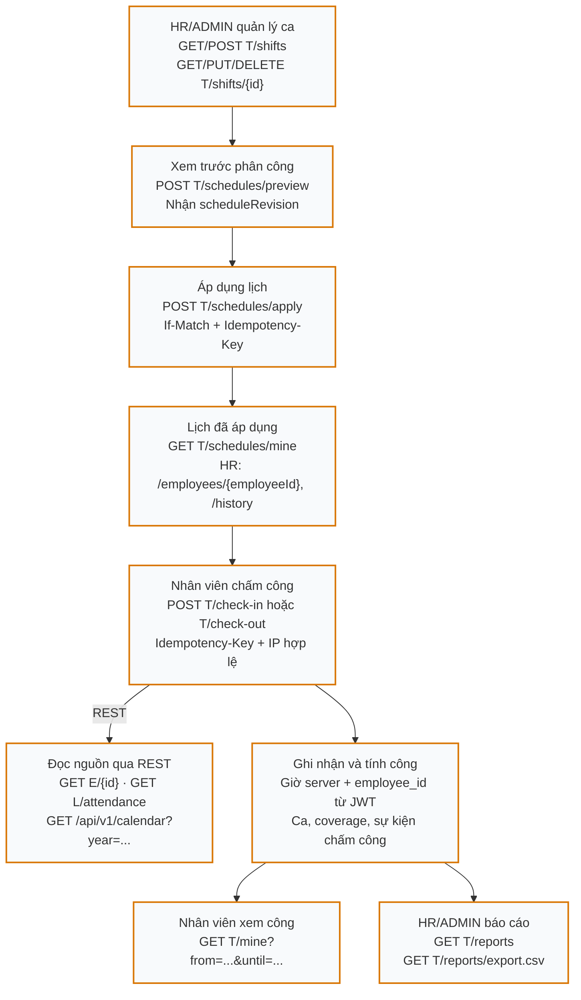
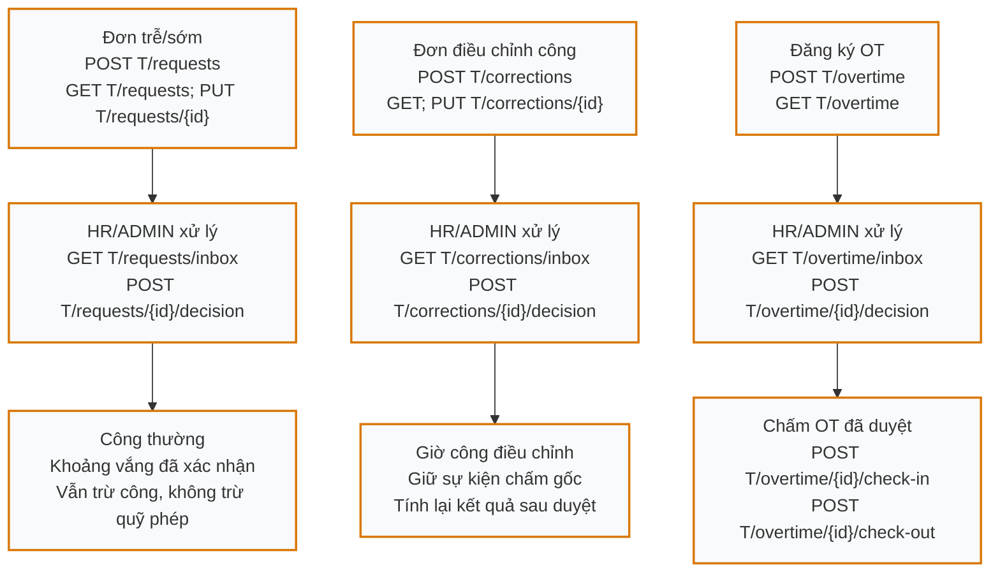
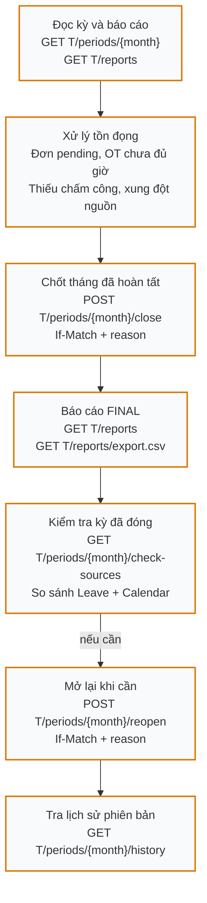
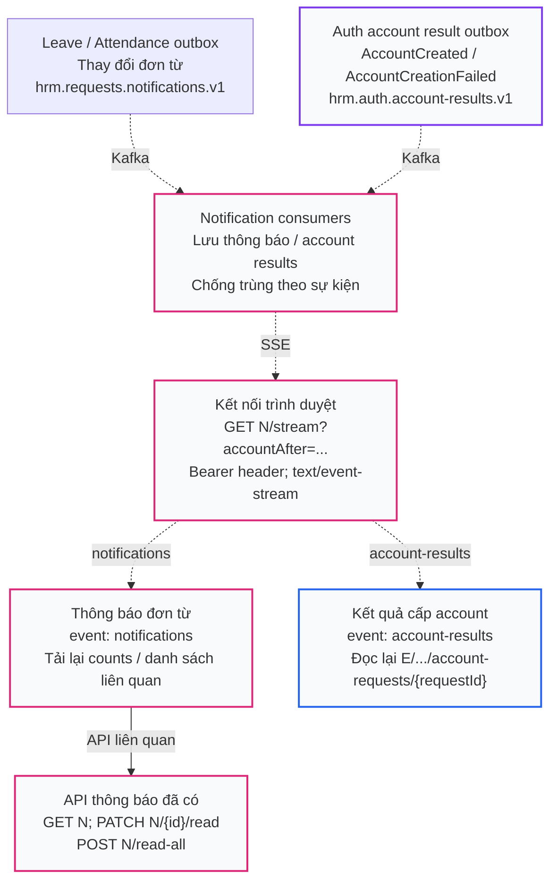

# Bản đồ endpoint và luồng nghiệp vụ Company HRM

Đối chiếu mã nguồn ngày 22/10/2026, commit `e81275a`. Đây là tài liệu hiện trạng, không phải API hoặc tính năng dự kiến.

Trong ứng dụng: **Trợ giúp → Sơ đồ endpoint** (`/help/endpoints`).

**[Mở bản trực quan HTML](../frontend/public/docs/endpoint-map.html)** — hoạt động offline, chọn luồng, phóng to/thu nhỏ và lọc endpoint. Trên GitHub, tải file HTML về rồi mở bằng trình duyệt; file Markdown này hiển thị Mermaid trực tiếp.

Phạm vi: **112 mapping HTTP trong controller**, bao gồm hai URL trang kích hoạt. Route có biến `action:approve|reject|cancel` được tính là một mapping. Endpoint do Spring/Actuator/Swagger tự cung cấp và ba alias health tại Gateway được ghi riêng, không cộng vào 112.

## Cách đọc

- Sơ đồ tổng quan thể hiện định tuyến. Trong sơ đồ nghiệp vụ, mũi tên liền thể hiện trình tự thao tác hoặc đọc lại dữ liệu; cạnh ghi **REST** mới biểu thị lời gọi backend trực tiếp.
- Mũi tên nét đứt thể hiện Kafka/outbox/SSE. Các worker hoặc thao tác người dùng giữa hai bước không có nghĩa hai endpoint tự gọi nhau.
- Request từ frontend đi qua Gateway; lời gọi liên service đi trực tiếp URL service nguồn và chuyển tiếp Bearer của người thao tác.
- ID số của Auth account khác UUID employeeId. HR/ADMIN duyệt nghiệp vụ; ADMIN quản trị account và gửi yêu cầu cấp account.

| Ký hiệu trên sơ đồ | Tiền tố thật |
| --- | --- |
| `A` | `/api/v1/auth` |
| `E` | `/api/v1/employees` |
| `C` | `/api/v1/calendar-events` |
| `L` | `/api/v1/leave/requests` |
| `T` | `/api/v1/attendance` |
| `N` | `/api/v1/notifications` |

## Chọn luồng

- [01 · Toàn hệ thống](#overview)
- [02 · Đăng nhập và bảo vệ API](#auth)
- [03 · Hồ sơ → cấp tài khoản → kích hoạt](#provisioning)
- [04 · Quản trị tài khoản](#accounts)
- [05 · Sự kiện công ty và Google Maps](#calendar)
- [06 · Xin nghỉ và tính ngày phép](#leave)
- [07 · Ca → lịch → chấm công → báo cáo](#attendance)
- [08 · Đơn trễ/sớm, sửa công và OT](#requests)
- [09 · Chốt và mở lại kỳ công](#period)
- [10 · Kafka → thông báo SSE → đọc lại API](#notifications)
- [Lời gọi REST trực tiếp](#rest-links)
- [Health và tài liệu API](#operations)
- [Toàn bộ endpoint theo controller](#inventory)

## 01 · Toàn hệ thống

Frontend đi qua Gateway. Các đường gọi REST trực tiếp, kiểm tra phiên và Kafka được tách trong các luồng chi tiết bên dưới.

- Mỗi service nghiệp vụ sở hữu database riêng; Gateway không có database.
- Gateway và từng resource service xác minh JWT rồi gọi trực tiếp GET A/session. Đây là bước xác thực, được lược khỏi sơ đồ tổng quan để dễ đọc.
- Các tên route workforce-service và biến WORKFORCE_SERVICE_URL trong Gateway trỏ đến Calendar, không phải một service Workforce riêng.
- MANAGER chưa có luồng duyệt cấp quản lý riêng. Quyền duyệt nghiệp vụ hiện là HR/ADMIN.

Đối chiếu nguồn: [application.yml](../back-end/modules/gateway/src/main/resources/application.yml), [SecurityConfig.java](../back-end/modules/gateway/src/main/java/com/api/gateway/config/SecurityConfig.java), [vite.config.js](../frontend/vite.config.js).

## 02 · Đăng nhập và bảo vệ API

A = /api/v1/auth. Luồng đăng nhập và luồng request có Bearer dùng hai nhánh; API bị 401 có thể thử refresh một lần.

- Đăng nhập mới thành công thay active_session_id và thu hồi refresh token cũ trong cùng transaction. Sai mật khẩu không hủy phiên đang dùng.
- POST A/logout dùng refresh cookie + CSRF; POST A/logout-all dùng Bearer + CSRF. Cả hai kết thúc phiên hiện hành khi thành công.
- GET A/session trả 204 khi hợp lệ. Phiên cũ bị từ chối khi xác thực; Auth không liên lạc được thì bên gọi trả 503, không coi là phiên hợp lệ.
- Frontend kiểm tra phiên mỗi 15 giây khi tab hiển thị, khi focus và visibilitychange. Mất kết nối không tự xóa phiên.
- GET A/csrf, POST A/login, POST A/refresh, POST A/logout, POST A/activate là các đường không đòi Bearer; các POST cookie vẫn có kiểm tra CSRF theo cấu hình.

Đối chiếu nguồn: [session.js](../frontend/src/auth/session.js), [cookies.js](../frontend/src/auth/cookies.js), [App.vue](../frontend/src/App.vue), [AuthController.java](../back-end/modules/auth-service-main/src/main/java/com/example/authservice/controller/AuthController.java), [AuthService.java](../back-end/modules/auth-service-main/src/main/java/com/example/authservice/service/AuthService.java), [SecurityConfig.java](../back-end/modules/auth-service-main/src/main/java/com/example/authservice/config/SecurityConfig.java).

## 03 · Hồ sơ → cấp tài khoản → kích hoạt

HR/ADMIN quản lý hồ sơ. ADMIN gửi yêu cầu cấp tài khoản. Việc cấp tài khoản đi qua outbox/Kafka, không phải Employee gọi POST A/register.

- Email chỉ được gửi khi activation/mail được bật và cấu hình. SUCCEEDED nghĩa là đã tạo account, chưa chứng minh đã giao email hoặc đã kích hoạt.
- GET/POST A/activation-invitations/{employeeId}: HR/ADMIN xem trạng thái hoặc gửi lại lời mời.
- Notification cũng nhận account-results để báo qua SSE. Frontend vẫn đọc lại Employee; hai consumer có thể hoàn tất khác thời điểm.
- PATCH E/{id}/status thay trạng thái lao động; không đồng nghĩa khóa account Auth. Email hồ sơ cũng không tự đổi email đăng nhập.
- POST A/register là đường ADMIN tạo trực tiếp khi provisioning tắt; khi provisioning bật, Auth từ chối đường này.

Đối chiếu nguồn: [AccountRequestController.java](../back-end/modules/employee-service/src/main/java/com/company/employee/provisioning/AccountRequestController.java), [SecurityConfig.java](../back-end/modules/employee-service/src/main/java/com/company/employee/config/SecurityConfig.java), [AccountRequestConsumer.java](../back-end/modules/auth-service-main/src/main/java/com/example/authservice/provisioning/AccountRequestConsumer.java), [AccountResultConsumer.java](../back-end/modules/employee-service/src/main/java/com/company/employee/provisioning/AccountResultConsumer.java), [ActivationController.java](../back-end/modules/auth-service-main/src/main/java/com/example/authservice/controller/ActivationController.java), [accountResults.js](../frontend/src/notifications/accountResults.js).

## 04 · Quản trị tài khoản

Chỉ ADMIN. ID tài khoản Auth là số; employeeId là UUID liên kết hồ sơ.

- Version của thao tác quản trị nằm trong JSON body, không dùng If-Match.
- Không cho ADMIN thao tác trên chính tài khoản đang dùng bằng endpoint actions; quản lý phiên của mình dùng logout/logout-all.
- Trạng thái account được đồng bộ về Employee qua lifecycle khi events được bật. Không gộp trạng thái account với trạng thái lao động.

Đối chiếu nguồn: [AccountManagementController.java](../back-end/modules/auth-service-main/src/main/java/com/example/authservice/accounts/AccountManagementController.java), [AccountManagementService.java](../back-end/modules/auth-service-main/src/main/java/com/example/authservice/accounts/AccountManagementService.java), [AccountModels.java](../back-end/modules/auth-service-main/src/main/java/com/example/authservice/accounts/AccountModels.java).

## 05 · Sự kiện công ty và Google Maps

C = /api/v1/calendar-events. HR/ADMIN quản trị sự kiện; người đã đăng nhập đọc lịch chung.

- Danh sách quản trị GET C nhận from/to, type/status và phân trang. GET /api/v1/calendar là dữ liệu lịch chung, không phải endpoint quản trị.
- Các PUT/PATCH/DELETE sự kiện dùng If-Match. Sự kiện đã bắt đầu không thể sửa/hủy; bản nháp có thể xóa.
- Hai GET lịch chung và phép cá nhân là các lời gọi frontend độc lập; Calendar không gọi Leave.
- GoogleMapsLink dùng location trên form hoặc chi tiết sự kiện. Đây là liên kết ngoài mở tab mới, không có endpoint backend Maps và không tự geocode địa chỉ.
- Attendance chỉ dùng HOLIDAY + allDay + PUBLISHED + audience ALL để giảm phần phải làm, không coi mọi sự kiện hoặc sự kiện đã hủy là ngày nghỉ.

Đối chiếu nguồn: [EventCalendarView.vue](../frontend/src/views/EventCalendarView.vue), [CalendarEventFormView.vue](../frontend/src/views/CalendarEventFormView.vue), [GoogleMapsLink.vue](../frontend/src/components/GoogleMapsLink.vue), [CalendarManagementController.java](../back-end/modules/calendar-service/src/main/java/com/company/calendar_service/calendar/CalendarManagementController.java), [CalendarService.java](../back-end/modules/calendar-service/src/main/java/com/company/calendar_service/calendar/CalendarService.java).

## 06 · Xin nghỉ và tính ngày phép

L = /api/v1/leave/requests. Dự tính ngày phép cần lịch làm việc từ Attendance; dữ liệu nghỉ phục vụ chấm công đi theo endpoint đọc riêng.

- Danh sách điều chỉnh dành HR/ADMIN: GET L/adjustments/inbox. Chủ đơn đọc GET L/{id}/adjustments theo phạm vi được cấp.
- POST L và duyệt APPROVED cũng kiểm tra lịch theo logic service; estimate chỉ để xem trước, không thay thế validation khi ghi.
- Phép ANNUAL trừ quỹ khi duyệt. Đơn và thao tác điều chỉnh có kiểm tra chủ sở hữu, quyền, trạng thái và version.
- Không có vòng REST: T/leave-calendar chỉ đọc lịch/ca, Employee, Calendar; không gọi Leave. L/attendance đọc repository; không gọi ngược Attendance.
- L/attendance có thể chứa PENDING/REJECTED/CANCELLED cùng APPROVED; Attendance tự chọn coverage được duyệt và dùng đơn chờ để kiểm tra chốt kỳ.
- PATCH duyệt/từ chối/hủy và thao tác adjustment dùng If-Match. action của adjustment là approve, reject hoặc cancel.

Đối chiếu nguồn: [LeaveController.java](../back-end/modules/leave-service/src/main/java/com/company/leave/request/LeaveController.java), [LeaveAdjustmentController.java](../back-end/modules/leave-service/src/main/java/com/company/leave/request/LeaveAdjustmentController.java), [LeaveService.java](../back-end/modules/leave-service/src/main/java/com/company/leave/request/LeaveService.java), [LeaveCalendarClient.java](../back-end/modules/leave-service/src/main/java/com/company/leave/request/LeaveCalendarClient.java), [LeaveCalendarController.java](../back-end/modules/attendance-service/src/main/java/com/company/attendance/controller/LeaveCalendarController.java).

## 07 · Ca → lịch → chấm công → báo cáo

T = /api/v1/attendance. Attendance sử dụng ca đã phân công, hồ sơ Employee và coverage từ Leave/Calendar.

- GET T/shifts/{id}/history và GET T/schedules/history lưu lịch sử ca/phân công. Sửa ca tạo phiên bản; lịch đã phân công không tự đổi nếu chưa áp dụng.
- Nguồn REST được WorkforceClient gọi trực tiếp bằng Bearer của người thao tác, không query database chéo service.
- Frontend không cung cấp giờ chấm hoặc IP đáng tin cậy. Backend dùng giờ server và allowlist/proxy tin cậy; lỗi nguồn không được biến thành dữ liệu nghỉ rỗng.
- POST T/employees/{employeeId}/days/{date}/refresh-coverage giúp HR/ADMIN cập nhật coverage với If-Match. GET cùng tiền tố /events đọc sự kiện gốc theo quyền.
- Báo cáo kỳ mở cập nhật coverage; báo cáo kỳ đã chốt đọc snapshot FINAL. Chi tiết đóng/mở kỳ nằm ở sơ đồ 09.

Đối chiếu nguồn: [ShiftController.java](../back-end/modules/attendance-service/src/main/java/com/company/attendance/controller/ShiftController.java), [ScheduleController.java](../back-end/modules/attendance-service/src/main/java/com/company/attendance/controller/ScheduleController.java), [AttendanceController.java](../back-end/modules/attendance-service/src/main/java/com/company/attendance/controller/AttendanceController.java), [WorkforceClient.java](../back-end/modules/attendance-service/src/main/java/com/company/attendance/service/WorkforceClient.java).

## 08 · Đơn trễ/sớm, sửa công và OT

Ba nhóm có endpoint riêng. requests = trễ/sớm; corrections = sửa công; overtime = đăng ký và chấm OT.

- POST tạo ba loại đơn dùng Idempotency-Key. PUT, POST decision và POST cancel dùng If-Match theo controller; quyền xét duyệt là HR/ADMIN và không tự duyệt đơn của mình.
- Chủ đơn có đường POST T/{requests|corrections|overtime}/{id}/cancel, tùy trạng thái cho phép.
- requests và corrections có GET /{id}, GET /{id}/history. Overtime không khai báo endpoint detail/history/PUT riêng trong controller hiện tại.
- GET T/requests/pending-count phục vụ badge trễ/sớm. Không suy ra endpoint pending-count cho corrections hoặc overtime.
- OT check-in/out có Idempotency-Key và kiểm tra mạng. OT không tự phát sinh từ việc đến sớm/ở lại muộn; phút OT tách khỏi công thường.
- Các thay đổi đơn có thể ghi notification outbox; cách nhận thông báo nằm ở sơ đồ 10.

Đối chiếu nguồn: [AttendanceRequestController.java](../back-end/modules/attendance-service/src/main/java/com/company/attendance/controller/AttendanceRequestController.java), [AttendanceCorrectionController.java](../back-end/modules/attendance-service/src/main/java/com/company/attendance/controller/AttendanceCorrectionController.java), [OvertimeController.java](../back-end/modules/attendance-service/src/main/java/com/company/attendance/controller/OvertimeController.java).

## 09 · Chốt và mở lại kỳ công

HR/ADMIN thao tác theo tháng YYYY-MM. Endpoint check-sources kiểm tra nguồn của kỳ đã đóng, không phải bước bắt buộc trước close.

- Close kiểm tra đơn pending (bao gồm phép và điều chỉnh phép), OT chưa hoàn tất, dữ liệu công và thay đổi nguồn; thất bại không tạo một kỳ đóng hợp lệ.
- Check-sources chỉ báo nguồn thay đổi, không sửa snapshot FINAL. Muốn cập nhật cần mở lại, xử lý dữ liệu và chốt lại.
- Thao tác có version và lý do; lịch sử lưu actor, thời gian và trạng thái. Hiện chưa có service hay endpoint tính lương.

Đối chiếu nguồn: [AttendancePeriodController.java](../back-end/modules/attendance-service/src/main/java/com/company/attendance/controller/AttendancePeriodController.java), [AttendancePeriodService.java](../back-end/modules/attendance-service/src/main/java/com/company/attendance/service/AttendancePeriodService.java), [AttendanceService.java](../back-end/modules/attendance-service/src/main/java/com/company/attendance/service/AttendanceService.java).

## 10 · Kafka → thông báo SSE → đọc lại API

N = /api/v1/notifications. Dữ liệu SSE thông báo thay đổi; frontend tải lại nguồn nghiệp vụ để cập nhật giao diện.

- GET N, PATCH read và POST read-all có trong backend; frontend hiện dùng notifications/api.js cho stream, không có client riêng cho toàn bộ hộp thư/đánh dấu đã đọc.
- Stream dùng fetch để gửi Bearer, không dùng EventSource với token trên URL. Notification kiểm tra lại session trong vòng tick và đóng stream khi hết hạn.
- Gateway có route stream riêng với response-timeout=-1. Frontend reconnect và dùng polling dự phòng cho counts/kết quả account.
- Các luồng Kafka/outbox chỉ chạy khi events/notifications được bật và Kafka/topic sẵn sàng. Không gửi refresh token/mật khẩu qua các topic này.

Đối chiếu nguồn: [NotificationController.java](../back-end/modules/notification-service/src/main/java/com/company/notification/NotificationController.java), [NotificationStreams.java](../back-end/modules/notification-service/src/main/java/com/company/notification/NotificationStreams.java), [NotificationConsumer.java](../back-end/modules/notification-service/src/main/java/com/company/notification/NotificationConsumer.java), [AccountResultConsumer.java](../back-end/modules/notification-service/src/main/java/com/company/notification/AccountResultConsumer.java), [stream.js](../frontend/src/notifications/stream.js), [accountResults.js](../frontend/src/notifications/accountResults.js).

## Lời gọi REST trực tiếp

| Bên gọi | Bên nhận | Endpoint | Mục đích |
| --- | --- | --- | --- |
| Gateway + resource services | Auth | `GET /api/v1/auth/session` | Kiểm tra phiên của Bearer hiện tại; gọi trực tiếp AUTH_SERVICE_URL. |
| Attendance | Employee | `GET /api/v1/employees/{id}` | Hồ sơ, hireDate, trạng thái và phạm vi nhân viên. |
| Attendance | Employee | `GET /api/v1/employees?page=...&size=100` | Danh sách nhân viên cho thao tác HR/ADMIN, có phân trang. |
| Attendance | Calendar | `GET /api/v1/calendar?year=...` | Đọc từng năm; chọn ngày nghỉ HOLIDAY còn hiệu lực. |
| Attendance | Leave | `GET /api/v1/leave/requests/attendance?from=...&until=...` | Coverage nghỉ và trạng thái đơn; employeeId tùy phạm vi. |
| Leave | Attendance | `GET /api/v1/attendance/leave-calendar?employeeId=...&from=...&until=...` | Ngày/ca có hiệu lực để dự tính, gửi và xét duyệt phép. |

Hai hướng Leave ↔ Attendance không tạo vòng request: `/leave-calendar` không gọi Leave, `/requests/attendance` không gọi Attendance. Calendar không trực tiếp gọi Leave hoặc Attendance.

### Hợp đồng cần giữ khi nối các bước

| Cơ chế | Áp dụng |
| --- | --- |
| Bearer | Request nghiệp vụ; Gateway và service đích đều kiểm tra phiên. |
| Refresh cookie + CSRF | Login/refresh/logout; logout-all còn yêu cầu Bearer. Lấy token bằng GET A/csrf và gửi X-XSRF-TOKEN. |
| If-Match | Cập nhật/lifecycle sự kiện; duyệt/hủy/điều chỉnh phép; cập nhật/xóa ca; áp dụng lịch; sửa/duyệt/hủy đơn công; refresh coverage; đóng/mở kỳ. Đối chiếu controller cho từng method. |
| Version trong body | POST A/accounts/{id}/actions dùng management version, khác If-Match. |
| Idempotency-Key | Cấp tài khoản qua Employee; áp dụng lịch; check-in/out; tạo đơn trễ/sớm, correction, OT; chấm OT. |
| Outbox + Kafka | Ghi nghiệp vụ và outbox trong transaction; consumer cập nhật bất đồng bộ. Frontend đọc lại API nguồn để chốt trạng thái hiển thị. |

## Health và tài liệu API

| URL qua Gateway | Đích |
| --- | --- |
| GET /api/v1/auth/health-check | Auth controller; kiểm tra DB. |
| GET /api/v1/employees/health-check | Employee controller; kiểm tra DB. |
| GET /api/v1/attendance/health-check | Attendance controller; kiểm tra DB. |
| GET /api/v1/calendar/health-check | Gateway đổi path thành /actuator/health tại Calendar. |
| GET /api/v1/leave/health-check | Gateway đổi path thành /actuator/health tại Leave. |
| GET /api/v1/notifications/health-check | Gateway đổi path thành /actuator/health tại Notification. |
| GET /actuator/health | Health của Gateway; không kiểm tra toàn bộ luồng nghiệp vụ. |

Các `/api/v1/.../health-check` qua Gateway yêu cầu xác thực. Quyền gọi thẳng health ở service có thể khác. Swagger/OpenAPI của từng service xem README service, không giả định Gateway tự proxy `/swagger-ui/**` hoặc `/v3/api-docs/**`.

## Toàn bộ endpoint theo controller

Bảng liệt kê method và path đã ghép tiền tố class + method. Query, body, role và trạng thái hợp lệ xem controller, service và SecurityConfig tương ứng. Không suy ra quyền chỉ từ tên endpoint.

### Auth · :8081 · 18 mapping

[README service](../back-end/modules/auth-service-main/README.md)

| Method | Path | Controller |
| --- | --- | --- |
| `GET` | `/api/v1/auth/accounts` | [AccountManagementController](../back-end/modules/auth-service-main/src/main/java/com/example/authservice/accounts/AccountManagementController.java#L16) |
| `GET` | `/api/v1/auth/accounts/{id}` | [AccountManagementController](../back-end/modules/auth-service-main/src/main/java/com/example/authservice/accounts/AccountManagementController.java#L26) |
| `GET` | `/api/v1/auth/accounts/{id}/audit` | [AccountManagementController](../back-end/modules/auth-service-main/src/main/java/com/example/authservice/accounts/AccountManagementController.java#L29) |
| `POST` | `/api/v1/auth/accounts/{id}/actions` | [AccountManagementController](../back-end/modules/auth-service-main/src/main/java/com/example/authservice/accounts/AccountManagementController.java#L37) |
| `POST` | `/api/v1/auth/activate` | [ActivationController](../back-end/modules/auth-service-main/src/main/java/com/example/authservice/controller/ActivationController.java#L29) |
| `GET` | `/api/v1/auth/activation-invitations/{employeeId}` | [ActivationController](../back-end/modules/auth-service-main/src/main/java/com/example/authservice/controller/ActivationController.java#L35) |
| `POST` | `/api/v1/auth/activation-invitations/{employeeId}` | [ActivationController](../back-end/modules/auth-service-main/src/main/java/com/example/authservice/controller/ActivationController.java#L40) |
| `GET` | `/activate` | [ActivationPageController](../back-end/modules/auth-service-main/src/main/java/com/example/authservice/controller/ActivationPageController.java#L17) |
| `GET` | `/activation/index.html` | [ActivationPageController](../back-end/modules/auth-service-main/src/main/java/com/example/authservice/controller/ActivationPageController.java#L17) |
| `GET` | `/api/v1/auth/csrf` | [AuthController](../back-end/modules/auth-service-main/src/main/java/com/example/authservice/controller/AuthController.java#L45) |
| `GET` | `/api/v1/auth/health-check` | [AuthController](../back-end/modules/auth-service-main/src/main/java/com/example/authservice/controller/AuthController.java#L51) |
| `POST` | `/api/v1/auth/register` | [AuthController](../back-end/modules/auth-service-main/src/main/java/com/example/authservice/controller/AuthController.java#L59) |
| `POST` | `/api/v1/auth/login` | [AuthController](../back-end/modules/auth-service-main/src/main/java/com/example/authservice/controller/AuthController.java#L65) |
| `POST` | `/api/v1/auth/refresh` | [AuthController](../back-end/modules/auth-service-main/src/main/java/com/example/authservice/controller/AuthController.java#L75) |
| `POST` | `/api/v1/auth/logout` | [AuthController](../back-end/modules/auth-service-main/src/main/java/com/example/authservice/controller/AuthController.java#L86) |
| `POST` | `/api/v1/auth/logout-all` | [AuthController](../back-end/modules/auth-service-main/src/main/java/com/example/authservice/controller/AuthController.java#L98) |
| `GET` | `/api/v1/auth/me` | [AuthController](../back-end/modules/auth-service-main/src/main/java/com/example/authservice/controller/AuthController.java#L105) |
| `GET` | `/api/v1/auth/session` | [AuthController](../back-end/modules/auth-service-main/src/main/java/com/example/authservice/controller/AuthController.java#L110) |

### Employee · :8082 · 16 mapping

[README service](../back-end/modules/employee-service/README.md)

| Method | Path | Controller |
| --- | --- | --- |
| `POST` | `/api/v1/departments` | [DepartmentController](../back-end/modules/employee-service/src/main/java/com/company/employee/controller/DepartmentController.java#L32) |
| `GET` | `/api/v1/departments` | [DepartmentController](../back-end/modules/employee-service/src/main/java/com/company/employee/controller/DepartmentController.java#L38) |
| `GET` | `/api/v1/departments/{id}` | [DepartmentController](../back-end/modules/employee-service/src/main/java/com/company/employee/controller/DepartmentController.java#L45) |
| `PUT` | `/api/v1/departments/{id}` | [DepartmentController](../back-end/modules/employee-service/src/main/java/com/company/employee/controller/DepartmentController.java#L50) |
| `GET` | `/api/v1/employees/health-check` | [EmployeeController](../back-end/modules/employee-service/src/main/java/com/company/employee/controller/EmployeeController.java#L40) |
| `POST` | `/api/v1/employees` | [EmployeeController](../back-end/modules/employee-service/src/main/java/com/company/employee/controller/EmployeeController.java#L49) |
| `GET` | `/api/v1/employees` | [EmployeeController](../back-end/modules/employee-service/src/main/java/com/company/employee/controller/EmployeeController.java#L55) |
| `GET` | `/api/v1/employees/{id}` | [EmployeeController](../back-end/modules/employee-service/src/main/java/com/company/employee/controller/EmployeeController.java#L62) |
| `PUT` | `/api/v1/employees/{id}` | [EmployeeController](../back-end/modules/employee-service/src/main/java/com/company/employee/controller/EmployeeController.java#L68) |
| `PATCH` | `/api/v1/employees/{id}/status` | [EmployeeController](../back-end/modules/employee-service/src/main/java/com/company/employee/controller/EmployeeController.java#L73) |
| `POST` | `/api/v1/positions` | [PositionController](../back-end/modules/employee-service/src/main/java/com/company/employee/controller/PositionController.java#L32) |
| `GET` | `/api/v1/positions` | [PositionController](../back-end/modules/employee-service/src/main/java/com/company/employee/controller/PositionController.java#L38) |
| `GET` | `/api/v1/positions/{id}` | [PositionController](../back-end/modules/employee-service/src/main/java/com/company/employee/controller/PositionController.java#L45) |
| `PUT` | `/api/v1/positions/{id}` | [PositionController](../back-end/modules/employee-service/src/main/java/com/company/employee/controller/PositionController.java#L50) |
| `POST` | `/api/v1/employees/{employeeId}/account-requests` | [AccountRequestController](../back-end/modules/employee-service/src/main/java/com/company/employee/provisioning/AccountRequestController.java#L16) |
| `GET` | `/api/v1/employees/{employeeId}/account-requests/{requestId}` | [AccountRequestController](../back-end/modules/employee-service/src/main/java/com/company/employee/provisioning/AccountRequestController.java#L25) |

### Calendar · :8083 · 8 mapping

[README service](../back-end/modules/calendar-service/README.md)

| Method | Path | Controller |
| --- | --- | --- |
| `GET` | `/api/v1/calendar` | [CalendarController](../back-end/modules/calendar-service/src/main/java/com/company/calendar_service/calendar/CalendarController.java#L26) |
| `GET` | `/api/v1/calendar-events` | [CalendarManagementController](../back-end/modules/calendar-service/src/main/java/com/company/calendar_service/calendar/CalendarManagementController.java#L24) |
| `GET` | `/api/v1/calendar-events/{id}` | [CalendarManagementController](../back-end/modules/calendar-service/src/main/java/com/company/calendar_service/calendar/CalendarManagementController.java#L33) |
| `POST` | `/api/v1/calendar-events` | [CalendarManagementController](../back-end/modules/calendar-service/src/main/java/com/company/calendar_service/calendar/CalendarManagementController.java#L38) |
| `PUT` | `/api/v1/calendar-events/{id}` | [CalendarManagementController](../back-end/modules/calendar-service/src/main/java/com/company/calendar_service/calendar/CalendarManagementController.java#L46) |
| `PATCH` | `/api/v1/calendar-events/{id}/publish` | [CalendarManagementController](../back-end/modules/calendar-service/src/main/java/com/company/calendar_service/calendar/CalendarManagementController.java#L53) |
| `PATCH` | `/api/v1/calendar-events/{id}/cancel` | [CalendarManagementController](../back-end/modules/calendar-service/src/main/java/com/company/calendar_service/calendar/CalendarManagementController.java#L59) |
| `DELETE` | `/api/v1/calendar-events/{id}` | [CalendarManagementController](../back-end/modules/calendar-service/src/main/java/com/company/calendar_service/calendar/CalendarManagementController.java#L66) |

### Leave · :8084 · 17 mapping

[README service](../back-end/modules/leave-service/README.md)

| Method | Path | Controller |
| --- | --- | --- |
| `GET` | `/api/v1/leave/requests/adjustments/inbox` | [LeaveAdjustmentController](../back-end/modules/leave-service/src/main/java/com/company/leave/request/LeaveAdjustmentController.java#L18) |
| `GET` | `/api/v1/leave/requests/{id}/adjustments` | [LeaveAdjustmentController](../back-end/modules/leave-service/src/main/java/com/company/leave/request/LeaveAdjustmentController.java#L23) |
| `POST` | `/api/v1/leave/requests/{id}/adjustments` | [LeaveAdjustmentController](../back-end/modules/leave-service/src/main/java/com/company/leave/request/LeaveAdjustmentController.java#L27) |
| `PATCH` | `/api/v1/leave/requests/{id}/adjustments/{adjustmentId}/{action:approve\|reject\|cancel}` | [LeaveAdjustmentController](../back-end/modules/leave-service/src/main/java/com/company/leave/request/LeaveAdjustmentController.java#L32) |
| `POST` | `/api/v1/leave/requests` | [LeaveController](../back-end/modules/leave-service/src/main/java/com/company/leave/request/LeaveController.java#L18) |
| `GET` | `/api/v1/leave/requests/mine` | [LeaveController](../back-end/modules/leave-service/src/main/java/com/company/leave/request/LeaveController.java#L24) |
| `GET` | `/api/v1/leave/requests/balance` | [LeaveController](../back-end/modules/leave-service/src/main/java/com/company/leave/request/LeaveController.java#L29) |
| `GET` | `/api/v1/leave/requests/calendar` | [LeaveController](../back-end/modules/leave-service/src/main/java/com/company/leave/request/LeaveController.java#L34) |
| `GET` | `/api/v1/leave/requests/inbox` | [LeaveController](../back-end/modules/leave-service/src/main/java/com/company/leave/request/LeaveController.java#L38) |
| `GET` | `/api/v1/leave/requests/pending-count` | [LeaveController](../back-end/modules/leave-service/src/main/java/com/company/leave/request/LeaveController.java#L43) |
| `GET` | `/api/v1/leave/requests/attendance` | [LeaveController](../back-end/modules/leave-service/src/main/java/com/company/leave/request/LeaveController.java#L47) |
| `GET` | `/api/v1/leave/requests/estimate` | [LeaveController](../back-end/modules/leave-service/src/main/java/com/company/leave/request/LeaveController.java#L54) |
| `GET` | `/api/v1/leave/requests/{id}` | [LeaveController](../back-end/modules/leave-service/src/main/java/com/company/leave/request/LeaveController.java#L60) |
| `GET` | `/api/v1/leave/requests/{id}/history` | [LeaveController](../back-end/modules/leave-service/src/main/java/com/company/leave/request/LeaveController.java#L62) |
| `PATCH` | `/api/v1/leave/requests/{id}/approve` | [LeaveController](../back-end/modules/leave-service/src/main/java/com/company/leave/request/LeaveController.java#L66) |
| `PATCH` | `/api/v1/leave/requests/{id}/reject` | [LeaveController](../back-end/modules/leave-service/src/main/java/com/company/leave/request/LeaveController.java#L71) |
| `PATCH` | `/api/v1/leave/requests/{id}/cancel` | [LeaveController](../back-end/modules/leave-service/src/main/java/com/company/leave/request/LeaveController.java#L76) |

### Attendance · :8085 · 49 mapping

[README service](../back-end/modules/attendance-service/README.md)

| Method | Path | Controller |
| --- | --- | --- |
| `POST` | `/api/v1/attendance/check-in` | [AttendanceController](../back-end/modules/attendance-service/src/main/java/com/company/attendance/controller/AttendanceController.java#L26) |
| `POST` | `/api/v1/attendance/check-out` | [AttendanceController](../back-end/modules/attendance-service/src/main/java/com/company/attendance/controller/AttendanceController.java#L32) |
| `GET` | `/api/v1/attendance/mine` | [AttendanceController](../back-end/modules/attendance-service/src/main/java/com/company/attendance/controller/AttendanceController.java#L38) |
| `GET` | `/api/v1/attendance/reports` | [AttendanceController](../back-end/modules/attendance-service/src/main/java/com/company/attendance/controller/AttendanceController.java#L44) |
| `GET` | `/api/v1/attendance/reports/export.csv` | [AttendanceController](../back-end/modules/attendance-service/src/main/java/com/company/attendance/controller/AttendanceController.java#L52) |
| `POST` | `/api/v1/attendance/employees/{employeeId}/days/{date}/refresh-coverage` | [AttendanceController](../back-end/modules/attendance-service/src/main/java/com/company/attendance/controller/AttendanceController.java#L66) |
| `GET` | `/api/v1/attendance/employees/{employeeId}/days/{date}/events` | [AttendanceController](../back-end/modules/attendance-service/src/main/java/com/company/attendance/controller/AttendanceController.java#L73) |
| `GET` | `/api/v1/attendance/corrections` | [AttendanceCorrectionController](../back-end/modules/attendance-service/src/main/java/com/company/attendance/controller/AttendanceCorrectionController.java#L24) |
| `GET` | `/api/v1/attendance/corrections/inbox` | [AttendanceCorrectionController](../back-end/modules/attendance-service/src/main/java/com/company/attendance/controller/AttendanceCorrectionController.java#L31) |
| `GET` | `/api/v1/attendance/corrections/{id}` | [AttendanceCorrectionController](../back-end/modules/attendance-service/src/main/java/com/company/attendance/controller/AttendanceCorrectionController.java#L39) |
| `GET` | `/api/v1/attendance/corrections/{id}/history` | [AttendanceCorrectionController](../back-end/modules/attendance-service/src/main/java/com/company/attendance/controller/AttendanceCorrectionController.java#L44) |
| `POST` | `/api/v1/attendance/corrections` | [AttendanceCorrectionController](../back-end/modules/attendance-service/src/main/java/com/company/attendance/controller/AttendanceCorrectionController.java#L51) |
| `PUT` | `/api/v1/attendance/corrections/{id}` | [AttendanceCorrectionController](../back-end/modules/attendance-service/src/main/java/com/company/attendance/controller/AttendanceCorrectionController.java#L59) |
| `POST` | `/api/v1/attendance/corrections/{id}/cancel` | [AttendanceCorrectionController](../back-end/modules/attendance-service/src/main/java/com/company/attendance/controller/AttendanceCorrectionController.java#L65) |
| `POST` | `/api/v1/attendance/corrections/{id}/decision` | [AttendanceCorrectionController](../back-end/modules/attendance-service/src/main/java/com/company/attendance/controller/AttendanceCorrectionController.java#L71) |
| `GET` | `/api/v1/attendance/periods/{month}` | [AttendancePeriodController](../back-end/modules/attendance-service/src/main/java/com/company/attendance/controller/AttendancePeriodController.java#L15) |
| `GET` | `/api/v1/attendance/periods/{month}/history` | [AttendancePeriodController](../back-end/modules/attendance-service/src/main/java/com/company/attendance/controller/AttendancePeriodController.java#L17) |
| `GET` | `/api/v1/attendance/periods/{month}/check-sources` | [AttendancePeriodController](../back-end/modules/attendance-service/src/main/java/com/company/attendance/controller/AttendancePeriodController.java#L19) |
| `POST` | `/api/v1/attendance/periods/{month}/close` | [AttendancePeriodController](../back-end/modules/attendance-service/src/main/java/com/company/attendance/controller/AttendancePeriodController.java#L23) |
| `POST` | `/api/v1/attendance/periods/{month}/reopen` | [AttendancePeriodController](../back-end/modules/attendance-service/src/main/java/com/company/attendance/controller/AttendancePeriodController.java#L26) |
| `GET` | `/api/v1/attendance/requests` | [AttendanceRequestController](../back-end/modules/attendance-service/src/main/java/com/company/attendance/controller/AttendanceRequestController.java#L23) |
| `GET` | `/api/v1/attendance/requests/inbox` | [AttendanceRequestController](../back-end/modules/attendance-service/src/main/java/com/company/attendance/controller/AttendanceRequestController.java#L30) |
| `GET` | `/api/v1/attendance/requests/{id}` | [AttendanceRequestController](../back-end/modules/attendance-service/src/main/java/com/company/attendance/controller/AttendanceRequestController.java#L38) |
| `GET` | `/api/v1/attendance/requests/pending-count` | [AttendanceRequestController](../back-end/modules/attendance-service/src/main/java/com/company/attendance/controller/AttendanceRequestController.java#L43) |
| `GET` | `/api/v1/attendance/requests/{id}/history` | [AttendanceRequestController](../back-end/modules/attendance-service/src/main/java/com/company/attendance/controller/AttendanceRequestController.java#L50) |
| `POST` | `/api/v1/attendance/requests` | [AttendanceRequestController](../back-end/modules/attendance-service/src/main/java/com/company/attendance/controller/AttendanceRequestController.java#L57) |
| `PUT` | `/api/v1/attendance/requests/{id}` | [AttendanceRequestController](../back-end/modules/attendance-service/src/main/java/com/company/attendance/controller/AttendanceRequestController.java#L65) |
| `POST` | `/api/v1/attendance/requests/{id}/cancel` | [AttendanceRequestController](../back-end/modules/attendance-service/src/main/java/com/company/attendance/controller/AttendanceRequestController.java#L71) |
| `POST` | `/api/v1/attendance/requests/{id}/decision` | [AttendanceRequestController](../back-end/modules/attendance-service/src/main/java/com/company/attendance/controller/AttendanceRequestController.java#L77) |
| `GET` | `/api/v1/attendance/health-check` | [HealthCheckController](../back-end/modules/attendance-service/src/main/java/com/company/attendance/controller/HealthCheckController.java#L18) |
| `GET` | `/api/v1/attendance/leave-calendar` | [LeaveCalendarController](../back-end/modules/attendance-service/src/main/java/com/company/attendance/controller/LeaveCalendarController.java#L20) |
| `GET` | `/api/v1/attendance/overtime` | [OvertimeController](../back-end/modules/attendance-service/src/main/java/com/company/attendance/controller/OvertimeController.java#L18) |
| `GET` | `/api/v1/attendance/overtime/inbox` | [OvertimeController](../back-end/modules/attendance-service/src/main/java/com/company/attendance/controller/OvertimeController.java#L20) |
| `POST` | `/api/v1/attendance/overtime` | [OvertimeController](../back-end/modules/attendance-service/src/main/java/com/company/attendance/controller/OvertimeController.java#L22) |
| `POST` | `/api/v1/attendance/overtime/{id}/decision` | [OvertimeController](../back-end/modules/attendance-service/src/main/java/com/company/attendance/controller/OvertimeController.java#L24) |
| `POST` | `/api/v1/attendance/overtime/{id}/cancel` | [OvertimeController](../back-end/modules/attendance-service/src/main/java/com/company/attendance/controller/OvertimeController.java#L26) |
| `POST` | `/api/v1/attendance/overtime/{id}/check-in` | [OvertimeController](../back-end/modules/attendance-service/src/main/java/com/company/attendance/controller/OvertimeController.java#L28) |
| `POST` | `/api/v1/attendance/overtime/{id}/check-out` | [OvertimeController](../back-end/modules/attendance-service/src/main/java/com/company/attendance/controller/OvertimeController.java#L30) |
| `GET` | `/api/v1/attendance/schedules/history` | [ScheduleController](../back-end/modules/attendance-service/src/main/java/com/company/attendance/controller/ScheduleController.java#L22) |
| `POST` | `/api/v1/attendance/schedules/preview` | [ScheduleController](../back-end/modules/attendance-service/src/main/java/com/company/attendance/controller/ScheduleController.java#L29) |
| `POST` | `/api/v1/attendance/schedules/apply` | [ScheduleController](../back-end/modules/attendance-service/src/main/java/com/company/attendance/controller/ScheduleController.java#L36) |
| `GET` | `/api/v1/attendance/schedules/mine` | [ScheduleController](../back-end/modules/attendance-service/src/main/java/com/company/attendance/controller/ScheduleController.java#L44) |
| `GET` | `/api/v1/attendance/schedules/employees/{employeeId}` | [ScheduleController](../back-end/modules/attendance-service/src/main/java/com/company/attendance/controller/ScheduleController.java#L49) |
| `GET` | `/api/v1/attendance/shifts` | [ShiftController](../back-end/modules/attendance-service/src/main/java/com/company/attendance/controller/ShiftController.java#L21) |
| `GET` | `/api/v1/attendance/shifts/{id}` | [ShiftController](../back-end/modules/attendance-service/src/main/java/com/company/attendance/controller/ShiftController.java#L24) |
| `GET` | `/api/v1/attendance/shifts/{id}/history` | [ShiftController](../back-end/modules/attendance-service/src/main/java/com/company/attendance/controller/ShiftController.java#L26) |
| `POST` | `/api/v1/attendance/shifts` | [ShiftController](../back-end/modules/attendance-service/src/main/java/com/company/attendance/controller/ShiftController.java#L29) |
| `PUT` | `/api/v1/attendance/shifts/{id}` | [ShiftController](../back-end/modules/attendance-service/src/main/java/com/company/attendance/controller/ShiftController.java#L35) |
| `DELETE` | `/api/v1/attendance/shifts/{id}` | [ShiftController](../back-end/modules/attendance-service/src/main/java/com/company/attendance/controller/ShiftController.java#L40) |

### Notification · :8086 · 4 mapping

[README service](../back-end/modules/notification-service/README.md)

| Method | Path | Controller |
| --- | --- | --- |
| `GET` | `/api/v1/notifications` | [NotificationController](../back-end/modules/notification-service/src/main/java/com/company/notification/NotificationController.java#L13) |
| `PATCH` | `/api/v1/notifications/{id}/read` | [NotificationController](../back-end/modules/notification-service/src/main/java/com/company/notification/NotificationController.java#L16) |
| `POST` | `/api/v1/notifications/read-all` | [NotificationController](../back-end/modules/notification-service/src/main/java/com/company/notification/NotificationController.java#L20) |
| `GET` | `/api/v1/notifications/stream` | [NotificationController](../back-end/modules/notification-service/src/main/java/com/company/notification/NotificationController.java#L23) |

## Cập nhật tài liệu

Khi đổi mapping, cập nhật cả sơ đồ, bảng và bản HTML. Đối chiếu `@RequestMapping` trên class với `@GetMapping`, `@PostMapping`, `@PutMapping`, `@PatchMapping`, `@DeleteMapping` trên method; kiểm tra thêm Gateway routes, SecurityConfig, REST client và Kafka listener. Các flow là bản mô tả theo code, không chứng minh service đã bật hay đang chạy ở môi trường triển khai.
